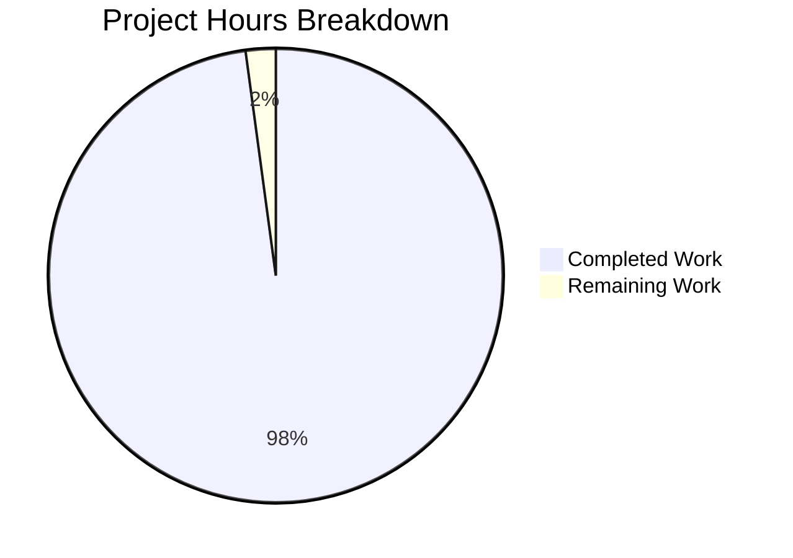

# 1. Executive Summary

SalesPro is delivered and verified: a browser-only storefront and sales back office in React 19 and TypeScript.

## 1.1 Project Overview

SalesPro is a self-contained retail application for two audiences. Shoppers get a home page, a 140-product catalogue with faceted search, product detail with reviews, a cart with promo codes, a three-step checkout, and an account with orders. An administrator signs in to a date-bounded dashboard and three exportable reports. It runs entirely in the browser with no server: data is seeded deterministically and reached through one typed service layer behind a single seam a real backend can replace.

## 1.2 Completion Status

**97.9% complete** — 1,652 of 1,688 scoped hours delivered and verified, 36 hours short across four requirements.



| Metric | Hours |
| --- | --- |
| Total Hours | 1,688 |
| Completed Hours (AI + Manual) | 1,652 |
| Remaining Hours | 36 |

Calculation: 1,652 ÷ (1,652 + 36) = **97.9%**. Scope is the plan's deliverables — the nine modules, their foundations, the suite and the documentation; deployment, CI and monitoring sit outside it.

## 1.3 Key Accomplishments

- [x] All nine planned modules delivered and exercised end to end.
- [x] 191 files under `src/`, 113 test files under `tests/`; all checks clean.
- [x] 2,188 tests pass: 97.19% statements, 92.53% branches.
- [x] Deterministic seed: 140 products, 20 categories, ~2,255 orders.
- [x] Money in integer minor units through one pricing service.
- [x] Accessibility by construction: dialogs, live regions, 44 px controls.
- [x] Security: no network egress, no secret, authorisation where the action happens.
- [x] Maintainer documents: `README.md`, three under `docs/`, the manifest.

## 1.4 Critical Unresolved Issues

**4 of the 32 requirements remain open in part.** None affects correctness: every module builds and passes its tests. Three are scale and record-keeping questions for an owner; one is logic held in more than one place.

| Issue | Impact | Owner | ETA |
| --- | --- | --- | --- |
| The delivered tree is 108,624 counted lines against a 50,000-line plan and its ±5% band, with 122 files beyond ±10% of their budgets | The plan's budget table no longer predicts file sizes, which changes review and maintenance cost; behaviour is unaffected | Plan owner with the maintainers | 8h to decide and re-baseline |
| 160 paths exist beyond the 157 the plan maps (108 split paths, 52 covering suites), and the suite accounts for 39,418 counted lines against its 7,350-line budget | The plan's file map understates the tree; each split path re-publishes the concern from the path its consumers already import | Plan owner | Included in the same decision |
| Two small duplications remain: the one-decimal rounding rule implemented in three data modules, and the feature-local country resolvers | A rounding or country rule could drift between copies | Maintainers | 10h |
| Five dependency versions stand above the plan's table (`react-router-dom`, `vite`, `vitest`, `@vitest/coverage-v8`, `typescript-eslint`), re-pinned past published advisories | The plan's dependency table no longer matches the manifest; the advisories themselves are cleared | Plan owner | Part of the 6h alignment task |

## 1.5 Access Issues

No access issues identified. The application needs no credential, environment file, database or external service, and makes no outbound request; a fresh checkout installs from the committed lock file, and the demonstration accounts are seeded in code.

## 1.6 Recommended Next Steps

1. **[High]** Settle the delivered scale: re-baseline the allocation, budgets and suite budget, or re-plan.
2. **[High]** Re-pin the plan's dependency table to the five declared versions.
3. **[Medium]** Consolidate the duplicated rounding rule and country resolvers.
4. **[Medium]** Close or record the residual branch arms in three seed modules.
5. **[Low]** Align the plan's prose with the seed volumes and spot-check the browser-only states.

# 2. Project Hours Breakdown

The hours below cover the scoped work only: the nine named modules, the shared foundations they import, the seeded data, the test suite and the documentation. Deployment configuration, containerisation, continuous integration and monitoring are outside the scope, so no path-to-production hours are counted.

## 2.1 Completed Work Detail

| Component | Hours | Description |
| --- | --- | --- |
| Foundations — shared types | 48 | The five shape modules under `src/types`: money units, paging, results and errors, catalogue, commerce, account and analytics shapes. |
| Foundations — constants, taxonomy and copy | 44 | Route builders, storage keys, tax and shipping configuration, the facet, sort, status and report vocabulary, and the user-facing copy with its split registers. |
| Foundations — utilities | 96 | The ten utility modules under `src/utils` and their split paths: formatting and the money rounding rule, dates and bucketing, strings and identifiers, validation, collections, statistics, URL query state, storage, async helpers and CSV. |
| Foundations — stylesheets | 88 | The token sheet plus the layout, component and area sheets that consume it: 21 stylesheets over one source of every colour, space, type, radius, shadow and z-index value. |
| Data access and transport | 140 | The in-process route table for the 32 documented endpoints, the typed client that is the only transport seam, the repositories over the seeded collections, and the durable write and session tables. |
| Domain services | 148 | The eight rule modules — catalogue, search, pricing, orders, authentication, customers, analytics and reports — plus the report-series and analytics-graph split paths. |
| Seeded data | 92 | The deterministic generators and hand-authored anchor records behind the catalogue, customers, orders, reviews and the daily sales fact table. |
| State layer | 92 | Five contexts, three reducers and the shared hooks that own session, cart, catalogue load status, the checkout machine and toasts. |
| Shared presentation | 196 | The shell components, thirteen UI primitives, the product card and gallery, and the SVG chart family with its scales, geometry and paired data tables. |
| Feature slices | 276 | The eight route-shaped modules across 49 files: home, catalogue, search, cart, checkout, account, administration and reports. |
| App shell | 32 | The route table with its lazy bindings and guards, the provider composition with the error boundary, and the mount that wires the stylesheets and the data source. |
| Test suite | 356 | 101 suites and 2,188 tests over the utilities, services, reducers, seeded data, primitives and journeys, with the coverage configuration they satisfy. |
| Documentation and build record | 44 | `README.md`, the three documents under `docs/` and the generation manifest that records every path's budget, status and count. |
| **Total** | **1,652** | Completed and verified work. |

## 2.2 Remaining Work Detail

| Category | Hours | Priority |
| --- | --- | --- |
| Settle the delivered scale: accept and re-baseline the line allocation, the per-file budgets and the suite budget, or re-plan them | 8 | High |
| Close or explicitly record the residual branch arms in the three seed modules | 8 | Medium |
| Consolidate the one-decimal rounding rule implemented three times across the data modules | 6 | Medium |
| Align the plan's documents with the delivered suite scale, the seeded volumes and the five re-pinned dependency versions | 6 | Low |
| Consolidate the feature-local country resolvers into the single home the taxonomy already owns | 4 | Low |
| Review the 122 recorded per-file budget deviations, and spot-check on real hardware the states a headless browser cannot render | 4 | Low |
| **Total** | **36** | |

## 2.3 Estimation Method and Confidence

Completed hours are estimated from what the tree holds, per component group, using base hours by category — 8 to 16 hours for a simple entity's read and write surface, 24 to 40 for a module carrying real business rules, and testing at roughly a third of the development hours on top. Every group traces to a plan requirement, so no hour is counted for work outside the scope.

Confidence is high for the completed side: the code, its tests and its runtime behaviour are all inspectable in the repository, and the delivered groups are large enough that each estimate rests on many files rather than one. The remaining side carries medium confidence — the scale decision's eight hours assume a review of the recorded deviations rather than a re-plan of the work, and the coverage and duplication items are small, well-bounded changes with tests already in place around them. Estimates are rounded up to the nearest half hour, and no hours are counted for the deployment, containerisation and monitoring work the plan places out of scope.

# 3. Test Results

The suite was run first-hand against this snapshot: `CI=true npm run coverage -- --maxWorkers=2` exits 0 with 101 test files and 2,188 tests passed, no failures and no skips. The rows below aggregate by capability rather than by file, so each row is one area of the product and the coverage figure is that area's own.

| Area / Category | Framework | Tests | Passed | Failed | Coverage | What This Proves |
| --- | --- | --- | --- | --- | --- | --- |
| Foundations — utilities | Vitest (node project) | 881 | 881 | 0 | 98.66% statements / 95.6% branches | Formatting and the money rounding rule, date arithmetic and bucketing, validation of every submit path, collection helpers, statistics, URL query state, storage and CSV behave as the domain requires. |
| Domain services | Vitest (node project) | 431 | 431 | 0 | 97.62% / 92.51% | Filtering, cross-filtered facet counts, search scoring, cart pricing and promo decisions, order construction from a snapshot, session issue and expiry, customer and address rules, aggregation and report rows. |
| State layer | Vitest (node and jsdom projects) | 143 | 143 | 0 | 96.46% / 94.17% | Cart, checkout and catalogue transitions, stock clamping, the single-submission guard, the query-fingerprint staleness rule and the shared hooks. |
| Seeded data and durable state | Vitest (node project) | 101 | 101 | 0 | 97.37% / 87.74% | The seeded collections are deterministic across two bootstrap passes, their invariants hold, and the durable write and session tables replay correctly. |
| Interfaces and components | Vitest (jsdom project) | 515 | 515 | 0 | Included in the repository-wide figure | Primitives, overlay focus and inert-background behaviour, table sorting and paging, chart geometry with its paired data tables, and each screen's loading, empty, error and loaded states. |
| Whole journeys | Vitest (jsdom project) | 117 | 117 | 0 | Included in the repository-wide figure | The shopping, checkout, account, address-book, session, shell, administration and reporting flows run end to end against the real providers and the real data seam, including their refusal and empty paths. |
| Repository-wide totals | Vitest 4 with V8 coverage | 2,188 | 2,188 | 0 | 97.19% statements / 92.53% branches / 98.23% functions / 98.22% lines | The suite is green in a single command and every configured threshold is met, including 85% statements and 80% branches for `src/utils`, `src/lib` and `src/state`. |

**Not Covered.** These were delivered but no test exercises them, and a reviewer should look at them before release:

- `src/main.tsx`, the mount shell, is excluded from coverage by configuration and has no test of its own; its effect (stylesheets loaded, data source bound, application mounted) is only visible when a page is served.
- The residual branch arms in `src/data/products.ts`, `orders.ts` and `productRules.ts` (75.0%, 77.35% and 77.5% branches): each is a refusal or a fallback over a module constant or a private generator draw that no caller input reaches, and `tests/unit/data/seedGuardBranches.test.ts` pins each one's premise rather than the arm itself.
- Hover-gated hover styles and the reduced-motion transitions. They are asserted through the CSS object model, because a headless browser reports no hover capability and no test framework animates; they were never rendered by an engine.
- The production bundle's behaviour under a browser. `npm run build` succeeds and the built output is served successfully, but the driven journeys ran against the development server, not against a served `dist/`.

# 4. Runtime Validation & UI Verification

Every line below was driven in a real browser against the running application, with no environment file present, and each was re-checked against the code afterwards.

- ✅ **Start-up and shell** — the development server serves the document and the built output; the shell renders one skip link, one header, one main region and one footer, with the administrator frame only for an administrator.
- ✅ **Home** — hero with its calls to action, a four-card featured strip, twelve category tiles summing 140 products and the promotional band; every image is an inline SVG data URI and **no request was made for an image file anywhere in the session**.
- ✅ **Catalogue and search** — "140 products match the current filters." over 12 tiles and a pager reading "Page 1 of 12", a brand facet narrowing to 16 through `?brandIds=…`, strictly non-decreasing prices under price-ascending, the sort surviving a chip removal, and "9 results for merino" with its announced count equal to the nine tiles; typing produced five settled suggestions with a polite announcement, and keyboard selection of the first suggestion opened its product route.
- ✅ **Product detail** — name, brand, price, availability line, five specification rows, the reviews panel with its rating filter and empty state, and the related-products strip; adding two units moved the header control to "Cart 2" with its badge and a confirmation toast.
- ✅ **Cart and promo codes** — two units priced to $51.90 subtotal and $56.18 total; SAVE10 applied with a −$5.19 discount row and a $50.56 total; an unrecognised code was refused with its stated reason and the applied code was kept.
- ✅ **Checkout and confirmation** — three steps, each with its own heading and the step indicator marking the current and completed steps; the review restated $59.55 and the masked card; one submit created exactly one order and emptied the cart; and **a full document reload of the confirmation URL re-rendered the whole order**, its line, delivery window and address, from the browser's durable write store and the per-order read credential.
- ✅ **Accounts** — `/account` redirected to `/login?returnTo=%2Faccount` with the return path preserved; sign-in, a profile edit that survived a reload, five orders with a working status filter and a detail showing the five-step timeline and reconciled totals; the address book added a labelled card, moved the default-shipping marker and removed a card only through its confirm dialog.
- ✅ **Administration and reports** — the dashboard's four KPI cards with their named comparison baseline, the chart redrawing from 12 categories to 3 channels when its series changed, all three reports with totals rows and paired charts, and a CSV export whose rows and totals match the on-screen table.
- ✅ **Authorisation and session** — a signed-in customer was refused at `/admin` in place with its explanatory sentence; signing out announced itself, cleared the session, and `/account` redirected to sign-in again.
- ✅ **Console and network hygiene** — 0 console errors, 0 console warnings, 0 responses at status 400 or above across every screen, and no failed request.

**Never exercised at runtime.** The declined-card path (its number is used by the suite, not by a browser run), the promo codes other than the one applied and the one refused, customer registration, an empty report range, order-history paging beyond its single page, the 320 px wordmark yield, and the hover-gated and reduced-motion states a headless browser cannot render.

# 5. Compliance & Quality Review

Each deliverable is shown in the state it stands in today, against the benchmark the specification set for it, with the repository path that carries it.

## 5.1 Compliance Matrix

| Deliverable | Benchmark | Status | Verified by |
| --- | --- | --- | --- |
| Home / landing page | Hero, featured products, category showcase and a promotional banner, routing into catalogue, search and cart | ✅ Pass | `src/features/home/`, driven in the browser, `tests/integration/shoppingFlow.test.tsx` |
| Product catalog | Listing by category with pagination; detail with gallery, description, specifications, reviews and related products | ✅ Pass | `src/features/catalog/`, `tests/integration/catalogBrowseFlow.test.tsx`, `tests/components/productDetailStates.test.tsx` |
| Search and filters | Full-text search with type-ahead; facet counts computed per facet; sorting, chips and URL-synchronised state reloading identically | ✅ Pass | `src/features/search/`, `src/utils/queryParams.ts`, `tests/integration/searchQueryConsistency.test.tsx`, `catalogUrlState.test.tsx` |
| Shopping cart | Add, update, remove and re-quantify within stock; promo codes with a stated refusal; one pricing service for every total; header mini-cart; persistence | ✅ Pass | `src/features/cart/`, `src/lib/pricingService.ts`, `src/state/cartReducer.ts`, `tests/integration/checkoutFlow.test.tsx` |
| Checkout flow | Ordered steps with per-step validation, saved-address reuse, a declined-card path, one order per submission, cart cleared, reload-safe confirmation | ✅ Pass | `src/features/checkout/`, `src/state/checkoutReducer.ts`, `tests/integration/checkoutFlow.test.tsx`, `checkoutPricingFailure.test.tsx` |
| Customer accounts | Register, sign in and out, session restore and expiry, profile, order history with detail, address book with defaults; own-data scoping and guarded routes | ✅ Pass | `src/features/account/`, `src/state/AuthContext.tsx`, `tests/integration/accountFlow.test.tsx`, `accountAddressBook.test.tsx`, `sessionLifecycle.test.tsx` |
| Admin sales dashboard | Administrator-only, date-bounded KPIs with a named baseline, a revenue series with bucket and series controls, a breakdown ring and two tables | ✅ Pass | `src/features/admin/`, `src/lib/analyticsService.ts`, `tests/integration/adminReportsFlow.test.tsx` |
| Reports | Three definitions over a range with presets and a persisted last-used range, totals rows, paired charts and a CSV matching the table | ✅ Pass | `src/features/reports/`, `src/lib/reportService.ts`, `src/utils/csv.ts`, `tests/integration/adminReportsFlow.test.tsx` |
| Test suite and coverage targets | Utilities, services and reducers in units; primitives, table and charts as components; the four journeys integrated; every module exercised; the configured bars met | ✅ Pass | 101 suites, 2,188 tests, 97.19% statements / 92.53% branches, thresholds in `vitest.config.ts` |
| Foundations, seeded data and determinism | One authoritative home per concern; money in integer minor units; one seeded generator with identical output per build | ✅ Pass | `src/utils/`, `src/data/`, `src/lib/pricingService.ts`, `tests/unit/data/`, `tests/unit/lib/mockServer.test.ts` |
| Code discipline: headers, the 600-line ceiling and the count record | Every file's header states its own line count; no file above the ceiling; one row per path with budget, status and count | ✅ Pass | Swept across all 305 header-carrying files (0 mismatches), no counted file above 600 lines, `generation-manifest.md` (157 counted files, 108,624 counted lines) |
| Accessibility, responsiveness, security and authorisation | Keyboard-operable overlays and controls, announced state changes, no network egress, no secret, authorisation where the action happens, validation on every submit | ✅ Pass | `src/styles/`, `src/components/ui/`, `src/lib/apiRoutes.ts`, `tests/components/` (40 suites), measured at six viewport widths |

## 5.2 AAP & Rule Divergences and Gaps

The plan records no user-specified rules for this project, so every departure below is a departure from a clause of the plan itself. None of them is a defect: the delivered code works as the plan intends, and each entry states what was agreed, what is in the repository instead, why, and what a human must decide.

| What the AAP/Rule Required | What Was Delivered Instead | Why It Diverged | Impact | Remediation |
| --- | --- | --- | --- | --- |
| Hold the delivered total within ±5% of the 50,000-line allocation (47,500–52,500) | 108,624 counted lines, with every file's real count and the remainder recorded in the reconciliation ledger | The plan forbids padding a finished file, cutting code it needs and raising the 600-line ceiling, so the required behaviour of nine modules could not be held inside the per-file budgets | Scale roughly twice the plan; review and maintenance cost, no behavioural impact | Accept and re-baseline the allocation, or re-plan it |
| The suite budgeted at 23 files and 7,350 lines | 110 test paths and 39,418 counted lines carrying 2,188 tests | The coverage bar (85% statements and 80% branches for the foundations, 80% statements repository-wide) over a tree twice the planned size | A ~70 s run and a larger suite to maintain | Re-baseline the suite budget with the rest |
| The tree maps exactly 157 paths | 160 further budget-free paths: 108 split paths (73 under `src/`, 18,330 lines; 35 under `tests/`, 9,936) and 52 covering suites (17,854) | The never-raised ceiling forced each over-sized concern into a second file, and the coverage bar required suites the plan maps no file for; each split path re-publishes from the planned path | The plan's file map understates the tree; consumers are unaffected | Fold the split records into the plan's map |
| Per-file budgets as allocated | 122 counted files deviate beyond ±10%, each with a ledger row and a one-line reason | Content wins over allocation: nothing was padded and nothing was cut | Budgets no longer predict file sizes | Review the ledger and re-baseline |
| The exact dependency pins of the plan's table | Five packages raised: `react-router-dom` 7.9.5 → 7.18.4, `vite` 7.1.12 → 7.3.7, `vitest` 4.0.6 → 4.1.12, `@vitest/coverage-v8` 4.0.6 → 4.1.12, `typescript-eslint` 8.46.2 → 8.58.2 | Published advisories against the pinned versions, cleared by re-declaring them within the same declared set | Advisories cleared; the plan's table is out of date | Re-pin the plan's table |
| "About 1,100 orders over the trailing 365 days" and facts across 20 categories and 3 channels | A two-year history of ~2,255 orders (~1,155 in the trailing year, which matches the plan's figure) with facts over the 12 leaf categories | The previous-year comparison baseline needs an earlier year, and only leaf categories hold products | More seeded data than the plan describes; comparisons work | Align the plan's prose with the delivered volumes |
| The named single homes and eight stylesheets of the plan's module map | The credential digest in `src/utils/credentials.ts` re-exported from `src/utils/strings.ts`; the transport across four modules; the data layer across six; ten stylesheets; extra feature files such as `PurchasePanel.tsx`, `OrderSummaryPanel.tsx` and `NotFoundView.tsx`; one tab-scoped storage key | The ceiling remedy plus the one-home rule applied to concerns that could not fit their planned files, and the session table's own scope | Readers still resolve at the planned paths; the module map understates the tree | Revise the map; no code change needed |
| The plan's letter for five behaviours (card rule, tooltip shape, `/admin` refusal, stock refusal, price-bound clamp) | Stricter or more explicit behaviour in each case | Each decided by a higher clause of the same plan — security, accessibility, authorisation, validation — or by observed behaviour | Strictly stricter, with nothing regressed | None required; the plan's prose could be brought level |

**The delivered scale against the allocation — the plan-owner decision.** The plan fixed the delivered total within ±5% of a 50,000-line allocation. The tree holds 108,624 counted lines: the 157 planned files' own 62,504 lines plus the 46,120 held by the 160 paths charged to them, recorded in `generation-manifest.md`. The cause is structural. The same plan forbids padding a finished file, cutting code it needs and raising the 600-line ceiling, so the remaining course was to record each file's real count and reallocate the remainder, which the ledger does per file, with a reason for every deviation beyond ten percent. A human must decide whether to accept that scale and re-baseline the plan, or to re-plan the work.

**The suite's scale against its budget.** The plan budgeted 23 test files and 7,350 lines. The suite is 110 test paths and 39,418 counted lines carrying 2,188 tests, as the manifest's area table shows. The cause is the coverage bar the same plan sets — 85% statements and 80% branches for `src/utils`, `src/lib` and `src/state`, and 80% statements repository-wide — applied to a tree twice the planned size, together with the covering suites the plan maps no file for. The suite itself is healthy: it runs green in one command and every threshold passes. A human has to decide whether that size is the right investment here, and if not, which coverage guarantees to trade away.

**Paths beyond the plan's map.** The plan maps 157 files and schedules them in batches of three to five. The tree holds 160 further paths carrying no budget of their own: 108 split paths and 52 covering suites, each charged to the planned file whose concern it serves. The splits exist because the never-raised 600-line ceiling made a second file the only permitted remedy for a concern that outgrew its home — `src/utils/strings.ts` at 531 with its digest in `src/utils/credentials.ts`, and `src/features/catalog/ProductDetailPage.tsx` at 454 with its buy column in `PurchasePanel.tsx`. Every one re-publishes from the path its consumers already import, so folding these records into the plan's map is documentation work.

**Per-file budgets against what each file holds.** The plan allocated a single integer budget to each of the 157 files. 122 now deviate by more than ten percent, each with a ledger row and a one-line reason: mandated documentation on exported surfaces, the class contracts a feature file must carry because it may not import a stylesheet, and the behaviour its own requirements add. The allocation rule is met as written. Nothing was padded to reach a number, nothing needed was cut to stay inside one, and no file breaches the 600-line ceiling. What a reader should decide is whether the budget table still helps at this scale or should yield to the ledger's counts.

**Dependency versions against the plan's table.** The plan pinned 22 packages to exact versions and forbade adding any beyond that set. The set is exactly as planned — three runtime packages and nineteen development ones, no excluded library anywhere in the tree — but five versions stand above it: `react-router-dom` 7.18.4, `vite` 7.3.7, `vitest` 4.1.12, `@vitest/coverage-v8` 4.1.12 and `typescript-eslint` 8.58.2. The cause is advisories published against the originally pinned versions, cleared by re-declaring those packages within the same set rather than by adding anything. The effect is a better security posture and a plan table that no longer matches `package.json`. Re-pinning the plan's table is the whole of the remedy.

**Seeded volumes against the plan's approximate figures.** The plan described about 1,100 orders over the trailing 365 days and a fact table spanning 20 categories and 3 channels. The seed generates a two-year history of about 2,255 orders — about 1,155 in the trailing year, which is the plan's figure — with 60 attributed to the seeded accounts, and keys its fact rows by the 12 leaf categories that hold products. Both departures are forced: the dashboard's previous-year baseline needs an earlier year to read, and a parent category holds no product, so a fact row for one would aggregate nothing. `README.md` and `docs/mock-api.md` state the delivered volumes; the plan's prose is what should move.

**Module placements against the plan's named homes.** The plan gives each concern a single named file and names eight stylesheets. The tree holds the credential digest in `src/utils/credentials.ts` re-exported from its planned path, the transport across four modules (`apiContract`, `apiRequests`, `apiRoutes`, `apiOrders`), the data layer across six, the report service and its series split, ten stylesheets, and extra feature files such as `PurchasePanel.tsx`, `OrderSummaryPanel.tsx`, `HeaderCartButton.tsx` and `NotFoundView.tsx`. Each was the plan's own ceiling remedy or its one-home rule applied to a concern its planned file could not hold, and each keeps the planned path as the import its consumers use. No code change is needed; the plan's module map is what understates the tree.

**Stricter behaviour than the plan's letter.** Five behaviours are stricter or more explicit than the plan describes: a card whose digits are all identical is refused ahead of the Luhn check; the tooltip is composed as a described-by hint on its trigger rather than as a dialog; a signed-in non-administrator is refused at `/admin` rather than redirected; a cart line naming a product the catalogue does not serve is refused as a stock problem; and a price-filter lower bound below the catalogue's cheapest product is clamped to the floor. Each was decided by a higher clause of the same plan, its security, accessibility, authorisation and validation requirements, and each is stated at the code, so nothing needs to change.

# 6. Risk Assessment

Risks below are forward-looking: what could still go wrong once this codebase leaves the demonstration environment. Nothing here has failed; each row is a condition a team should plan against.

| Risk | Category | Severity | Probability | Mitigation | Status |
| --- | --- | --- | --- | --- | --- |
| Delivered scale — 108,624 counted lines against a 50,000-line allocation, with 122 files beyond ±10% of their budgets | Technical | Medium | High | Accept and re-baseline the plan; keep the manifest's per-file ledger as the size record; require a split review on any file nearing 600 lines | Open — needs a plan-owner decision (8 h) |
| Residual branch coverage in three data modules: `src/data/products.ts` 75.0%, `src/data/orders.ts` 77.35%, `src/data/productRules.ts` 77.5% | Technical | Low | Low | Each arm is a refusal or fallback over a module constant or a private generator draw no caller input reaches; re-open if a caller surface is added, or extend the unit suite for the three files | Open — 8 h of optional work |
| Accessibility and motion states that CSS carries: focus rings, hover affordances, `prefers-reduced-motion` | Technical | Low | Low | Assert them in a browser-based accessibility pass rather than in jsdom, which computes no stylesheet cascade; the tokens themselves are single-homed and unit-tested | Open — part of the 4 h review task |
| The seam simulates the network in-process rather than over HTTP | Integration | Medium | Medium | The seam applies real latency and the shared request/response types, and routes are exercised in both success and refusal paths; before wiring a real backend, run a contract test per route against the live service | Open — by design for this project |
| A placed order's confirmation survives a reload through browser-local durable state, not a server | Operational | Medium | Low | Verified: the confirmation route re-renders the full order after a document reload, and the stored write carries the seed hash. A deployed instance should move that state server-side so the URL is not the only handle | Accepted — documented in `README.md` |
| Suite runtime under host load: 101 files in ~70 s, against a 30 s per-test allowance | Operational | Low | Medium | Run with `--maxWorkers=2` on shared capacity; keep the per-test allowance so a slow suite fails loudly rather than flaking; the shuffle check passes at a fixed seed | Managed — no action required |
| Demonstration-only authentication: the credential digest and the session table ship in the bundle | Security | High | Low | Correct for a client-rendered demonstration with no server; replace both with a server-issued session before any deployment that carries real accounts | Accepted — deployment precondition |
| CSV export writes user-controlled text into a file that a spreadsheet will evaluate | Security | Low | Low | Values are quoted and newline-safe; add a leading apostrophe guard on cells beginning `=`, `+`, `-` or `@` if reports are ever exported from data an external user controls | Open — low priority |

# 7. Visual Project Status


**Completed 1,652 h of 1,688 h — 97.9%.**

Remaining hours by category, as detailed in Section 2.2:

| Category | Hours | Priority |
| --- | --- | --- |
| Scale decision and plan re-baseline | 8 | High |
| Residual branch coverage in three data modules | 8 | Medium |
| Duplicated one-decimal rounding in three data modules | 6 | Medium |
| Plan-document alignment with the delivered tree | 6 | Low |
| Duplicated country resolvers across features | 4 | Low |
| Deviation review and device spot-check | 4 | Low |
| **Total** | **36** | |

Priority distribution of the remaining work: 8 h High, 14 h Medium, 14 h Low.

Completion by requirement: **28 of 32 requirements are fully met**; 4 remain open in part — the delivered scale against the allocation, the file set beyond the plan's map, the plan-document alignment, and maintainability of the few duplicated rules. Every one of the nine planned modules is delivered and verified; the four open items are plan-conformance and cleanup work rather than missing capability, which is why the 36 hours are small against 1,652 completed.

# 8. Summary & Recommendations

**Delivered and verified.** SalesPro is complete as a client-rendered React 19.2.0 + TypeScript 5.9.3 + Vite 7.3.7 single-page application: a storefront for shoppers and a sales back office for administrators, sharing one typed data layer over a deterministic in-browser mock. All nine planned modules are in the tree and exercised — the shared primitives and design tokens, the routing shell and header, the data and transport layers, the state contexts, the storefront features from the home and category bands through catalogue, search, product detail, cart, checkout and accounts, the administration dashboard and the three reports with CSV export, and the seeded dataset behind them. Verification is first-hand: 101 suites and 2,188 tests pass in one command at 97.19% statements and 92.53% branches with every configured threshold met, `tsc --noEmit`, `eslint .` and `prettier --check .` are clean, and the production bundle builds and serves. Ten storefront journeys and ten administration journeys were driven in a real headless browser, with zero console errors, zero warnings, no response at 400 or above and not one image request.

**Scale is the headline fact.** The plan allocated 50,000 lines across 157 files; the tree holds 108,624 counted lines across 318 paths, with every file's real count recorded and every deviation beyond ten percent given a reason, and no counted file breaching the 600-line ceiling. That is 62,504 lines in the planned files plus 46,120 in the split paths and covering suites charged to them. The cause is structural: the plan forbids padding a finished file, cutting code that is needed and raising the ceiling, so the only remaining course was honest accounting. It makes the first human decision a planning one rather than a coding one.

**Completion stands at 97.9%** — 1,652 hours delivered of 1,688 scoped, with 28 of 32 requirements fully met and 4 open in part: the scale question above, the file set beyond the plan's map, the plan documents that still describe the pre-delivery tree, and a handful of duplicated rules. Thirty-six hours remain, none of it blocking: 8 h High to decide and re-baseline the allocation, 14 h Medium to close the residual branch arms and de-duplicate the rounding helpers, and 14 h Low for the documentation pass and a device spot-check. Nothing in the remaining list is missing behaviour; every gap is conformance or cleanup.

**The critical path to production** is short and mostly outside the code. First, decide the scale question and re-baseline the plan, since it changes what "done" means for every later review (**8 h**). Second, align the plan documents and the package pin table with the delivered tree (**6 h**). Third, close the residual coverage and duplication work if the team wants the foundations uniformly above their bars (**14 h**). Then the deployment changes a client-only demonstration needs: replace the browser-local durable state a placed order relies on with a server-issued session, and replace the seeded credential digest and session table with real authentication before any instance carries accounts.

**Production readiness.** The application is production-ready as a demonstration and as a front end: the build is clean, the suite is comprehensive, the accessibility affordances and keyboard paths are exercised, and the runtime walkthrough found no console noise or failing request. It is not yet ready to carry real accounts or real orders, for the two reasons above rather than for any defect in what was delivered. The measurable success criteria are met — every configured coverage bar, zero lint and type errors, every route and flow driven end to end in a real browser, and a deterministic seed that makes any finding reproducible from a fixed checkout.

# 9. Development Guide

Every command below was run on this checkout and its observed result is stated beside it.

### System Prerequisites

| Requirement | Version | Notes |
| --- | --- | --- |
| Node.js | v22.23.3 (floor `>=22.12.0`) | Declared in `package.json` `engines`; the floor is what Vite 7, `@vitejs/plugin-react` 5, jsdom 27 and Vitest 4 require |
| npm | 11.21.0 | Resolves the lock file with `npm ci` |
| Browser | Any current evergreen build | Only for manual walkthroughs; the suite runs in jsdom |
| Server, database, container | None | Nothing to install or start — the data layer is in-browser |

### Initial Setup

```bash
# From the repository root
CI=true npm ci --offline --no-fund --no-audit     # exit 0, ~2 s from a warm npm cache
```

If the lock file is missing or has changed, fall back to `CI=true npm install --no-fund --no-audit`. `CI=true` matters: it keeps npm and the test runner non-interactive. Never run `npm cache clean` — the npm cache is shared host-wide and is what makes the install take seconds rather than a minute.

No `.env` file is needed and none should be committed. `VITE_APP_NAME` and `VITE_API_LATENCY_MS` are inert placeholders (`.env.example` documents them) and every read supplies a default in `src/constants/config.ts`, so the application runs identically with no environment set. No secret or token is required anywhere.

### Verification Commands

```bash
npm run typecheck                                 # tsc --noEmit over src and tests — exit 0, silent
npm run lint                                      # eslint . — exit 0, silent
CI=true npm test -- --maxWorkers=2                # 101 files, 2,188 tests passed
CI=true npm run coverage -- --maxWorkers=2        # same suite + thresholds and a coverage table
npm run build                                     # tsc --noEmit && vite build — exit 0, ~2 s
npx prettier --check .                            # "All matched files use Prettier code style!"
```

Observed coverage on this tree: **97.19% statements, 92.53% branches, 98.23% functions, 98.22% lines** repository-wide, with `src/utils` at 98.66/95.6, `src/lib` at 97.62/92.51, `src/state` at 96.46/94.17 and `src/data` at 97.37/87.74. The thresholds in `vitest.config.ts` are 80% statements repository-wide and 85% statements / 80% branches for `src/utils`, `src/lib` and `src/state`; all pass, and none should be lowered. `--maxWorkers=2` keeps the run inside shared host capacity; the suite completes in about 70 s. Run the whole gate in one line when changing anything broad:

```bash
npm run typecheck && npm run lint && CI=true npm run coverage -- --maxWorkers=2 && npm run build
```

Scope a single change with, for example, `CI=true npx vitest run --maxWorkers=2 tests/unit/utils/validation.test.ts` and `npx eslint <changed files> --no-fix`.

### Running the Application

```bash
npm run dev -- --port 5740 --strictPort           # Vite dev server, ready in ~155 ms
npm run preview -- --port 5741 --strictPort       # serves the built dist/ after npm run build
```

Always pass an explicit port and `--strictPort` on a shared host, so a collision fails loudly instead of taking another process's port; never leave the dev server on Vite's default 5173. Start it detached and probe readiness without network tools:

```bash
setsid npm run dev -- --port 5740 --strictPort > "$HOME/dev.log" 2>&1 &
echo $!                                            # record this pid
sleep 3; curl -sS -o /dev/null -w "%{http_code}\n" http://127.0.0.1:5740/   # 200
```

Stop the server by that exact pid (`kill <pid>`); `lsof`, `ss`, `netstat` and `fuser` are not installed here, so `curl` is the readiness probe. Never stop a server by process name or process group — the group may contain the shell you are working in.

### Example Usage

Open `http://127.0.0.1:5740/` and sign in with a seeded account:

| Account | Email | Password | Lands on |
| --- | --- | --- | --- |
| Administrator | `admin@salespro.test` | `Shopper1234` | Dashboard, reports, catalogue administration |
| Customer | `shopper@salespro.test` | `Shopper1234` | Account, orders, addresses, cart |

Browsing needs no sign-in. Product detail pages serve any seeded slug, for example `/product/boreal-outdoors-signature-merino-half-zip-sweater`; the two listing surfaces are `/catalog` (filters in the query string, 140 products over 12 pages) and `/search?q=merino`. At checkout, `4242424242424242` is authorised and `4000000000000002` is declined; promotions include `SAVE10`, `SAVE15`, `FLAT500`, `FREESHIP`, `BEAUTY15` and `AUDIO20`, with `SUMMER25` expired and `RETIRED10` inactive. `npm run build && npm run preview -- --port 5741 --strictPort` exercises the same application from the compiled bundle.

### Troubleshooting

| Symptom | Cause and fix |
| --- | --- |
| `npm ci` fails with a lock-file error | The lock file and `package.json` disagree; run `CI=true npm install --no-fund --no-audit`, then commit the refreshed lock file |
| `EADDRINUSE` on start | Another process holds the port; pick a different one and keep `--strictPort` so the failure stays visible |
| A test run appears to hang | The runner is watching; prefix the command with `CI=true` and pass a file path or `run` |
| `Could not resolve entry module "index.html"` | The build is being run from outside the repository root; `cd` to the root first |
| One console `GET /favicon.ico -> 404` | Only if `index.html` loses its icon declaration; it ships `<link rel="icon" href="data:," />`, which keeps the console completely clean |
| A download does not reach disk in a headless browser | The browser's download behaviour, not the application; assert on the emitted file's name and bytes instead |
| Coverage thresholds fail on a partial tree | Expected before the full suite exists; never lower a threshold — run the whole suite |

# 10. Appendices

### A. Command Reference

All commands run from the repository root.

| Command | Purpose | Observed result |
| --- | --- | --- |
| `CI=true npm ci --offline --no-fund --no-audit` | Install exactly what the lock file pins | exit 0, 287 packages, ~2 s from a warm cache |
| `CI=true npm install --no-fund --no-audit` | Fallback when the lock file is missing or changed | exit 0 |
| `npm run typecheck` | `tsc --noEmit` over `src` and `tests` | exit 0, silent |
| `npm run lint` | `eslint .` with the flat config | exit 0, silent |
| `npm test` | `vitest run` — the whole suite once, no watch | exit 0 |
| `CI=true npm test -- --maxWorkers=2` | The same run with capped workers on shared capacity | exit 0, 101 files, 2,188 tests passed |
| `CI=true npm run coverage -- --maxWorkers=2` | Suite plus the v8 coverage table and thresholds | exit 0; 97.19% statements, 92.53% branches |
| `npm run build` | `tsc --noEmit && vite build` into `dist/` | exit 0, ~2 s, a chunk per lazy route |
| `npm run preview -- --port 5741 --strictPort` | Serve the built bundle | HTTP 200 |
| `npm run dev -- --port 5740 --strictPort` | Vite dev server with HMR | ready in ~155 ms, HTTP 200, title `SalesPro` |
| `npx prettier --check .` | Formatting check | "All matched files use Prettier code style!" |
| `npm run format` | Rewrite files to Prettier's style | use deliberately, not during review |
| `CI=true npx vitest run --maxWorkers=2 tests/unit/utils/validation.test.ts` | A single file, for a scoped change | exit 0 |
| `CI=true npx vitest run --maxWorkers=2 --sequence.shuffle --sequence.seed=20261019` | Whole suite under shuffled order, to catch order dependence | exit 0 |
| `npx eslint <changed files> --no-fix` | Read-only lint on the files a change touches | exit 0 |
| `curl -sS -o /dev/null -w "%{http_code}\n" http://127.0.0.1:5740/` | Readiness probe for a running server | `200` |

### B. Port Reference

| Service | Default | Use instead | Notes |
| --- | --- | --- | --- |
| Vite dev server | 5173 | 5740 | Always pass `--port` and `--strictPort`; the host is shared and a silent port takeover is worse than a failure |
| Vite preview | 4173 | 5741 | Serve the built bundle from `dist/` |
| Application HTTP (in tests) | none | none | The suite mounts the application in jsdom; no socket is opened and no server needs to run |

### C. Key File Locations

| Path | What lives there |
| --- | --- |
| `index.html`, `src/main.tsx`, `src/App.tsx` | Entry shell: the mount point, the provider tree and the icon declaration that keeps the console clean |
| `src/Router.tsx` | Every route, including the lazy-loaded administration and report chunks |
| `src/constants/` | Routes, copy, taxonomy, checkout copy, configuration defaults and the storage-key contract |
| `src/types/` | The shared domain and API types that the seam and the services both satisfy |
| `src/lib/` | The transport and services: `apiContract`, `apiRequests`, `apiRoutes`, `mockServer`, and the catalog, search, cart, pricing, order, customer, auth, analytics and report services |
| `src/data/` | The deterministic seed: products, anchors, categories, customers, orders, reviews, sales history, the session table and the write stores |
| `src/state/` | The five contexts plus their reducers, the async-query hook, the focus hooks and the scroll hooks |
| `src/features/` | `home`, `catalog`, `search`, `cart`, `checkout`, `account`, `admin`, `reports` |
| `src/components/` | `ui` primitives, `product` cards, `layout` shell and `charts` renderers |
| `src/styles/` | 21 stylesheets, `tokens.css` first |
| `src/utils/` | Formatting, storage, validation, query-string and accessibility helpers |
| `tests/unit/`, `tests/components/`, `tests/integration/` | The suite, with `tests/setup.ts`, `tests/testUtils.tsx`, `tests/fixtures.ts` and `tests/helpers/` shared by all three |
| `vite.config.ts`, `vitest.config.ts`, `tsconfig.json`, `eslint.config.js`, `.prettierrc.json` | Build, test, type, lint and format configuration |
| `README.md`, `docs/architecture.md`, `docs/mock-api.md`, `docs/contributing.md` | Onboarding, architecture, the seam's contract and contribution rules |
| `generation-manifest.md` | The per-file ledger: each file's budget, actual count and reason wherever it deviates |

### D. Technology Versions

Runtime: **Node.js v22.23.3**, **npm 11.21.0** (both above the `engines` floor of Node `^20.19.0 || ^22.12.0 || >=24.0.0`).

| Package | Version | Role |
| --- | --- | --- |
| `react`, `react-dom` | 19.2.0 | UI runtime |
| `react-router-dom` | 7.18.4 | Routing, including lazy route chunks |
| `typescript` | 5.9.3 | Types; strict, `noEmit`, `verbatimModuleSyntax` |
| `vite` | 7.3.7 | Dev server and bundler (`es2022` target) |
| `@vitejs/plugin-react` | 5.1.0 | JSX transform and Fast Refresh |
| `vitest` | 4.1.12 | Test runner, with `node` and `jsdom` projects |
| `@vitest/coverage-v8` | 4.1.12 | Coverage provider and thresholds |
| `jsdom` | 27.1.0 | DOM for component and integration tests |
| `@testing-library/react`, `/dom`, `/jest-dom`, `/user-event` | 16.3.0, 10.4.1, 6.9.1, 14.6.1 | Component assertions and user interaction |
| `eslint`, `@eslint/js` | 9.39.0 | Flat-config linting |
| `typescript-eslint` | 8.58.2 | TypeScript rules |
| `eslint-plugin-react-hooks` | 7.0.1 | Hook rules |
| `globals` | 16.4.0 | Environment globals for the lint config |
| `prettier` | 3.6.2 | Formatting |
| `@types/node`, `@types/react`, `@types/react-dom` | 22.18.13, 19.2.2, 19.2.2 | Type declarations |

### E. Environment Variable Reference

The application needs no environment variables and runs identically with no `.env` file present. Both variables below are inert placeholders documented in `.env.example`; every read supplies a default in `src/constants/config.ts`.

| Variable | Default | Effect |
| --- | --- | --- |
| `VITE_APP_NAME` | `SalesPro` | The product name the shell and the document title use |
| `VITE_API_LATENCY_MS` | `120` (0 under test) | Simulated latency the seam applies to each call, so loading states are reachable |
| `CI` | unset | Set to `true` in any automated run so npm and Vitest stay non-interactive |

Never commit a real `.env`, a credential or a token. Demonstration credentials are seeded in code and are not secrets.

### F. Developer Tools Guide

- **Types before tests.** `npm run typecheck` covers `src` and `tests`, so a stale reference in a spec fails the same way as one in a component. Run it first after any rename.
- **Two Vitest projects.** `vitest.config.ts` runs `tests/unit/**` in a `node` environment and `tests/components/**` plus `tests/integration/**` in `jsdom`, each inheriting the root config. Put a DOM-free unit test under `tests/unit/` to keep it fast.
- **Coverage globs.** Coverage includes `src/**/*.{ts,tsx}`, excluding `*.d.ts` and `src/main.tsx` (the entry shell). Thresholds are enforced, so a new file with no tests moves the number.
- **The suite runs once.** `npm test` maps to `vitest run`; there is no watch mode to escape. Use `npx vitest` directly only when you want watch.
- **Prettier is the tie-breaker.** Run `npx prettier --check .` before pushing; the whole repository is currently clean, and `npm run format` fixes any drift in place.
- **Browser checks are separate.** jsdom computes no stylesheet cascade, so anything that depends on layout, hover or media queries has to be verified in a real browser. Start the dev server on an explicit port, drive the flow, and stop it by the pid you printed.
- **Never stop a process by name.** Process-group and name-based kills can take down the shell you are working in. Record the pid you started and stop that pid.

### G. Glossary

| Term | Meaning here |
| --- | --- |
| Seam | `src/lib/apiContract.ts` and `mockServer.ts`: the single typed boundary every data read and write passes through, so a real backend can replace it without touching a component |
| Counted line | A line in a tracked source, test, style, configuration or documentation file that the plan's line budget accounts for |
| Budgeted file | One of the 157 files the plan allocates a line budget to |
| Budget-free path | A file the plan maps no budget for: either a split path carved out of a budgeted file or a covering suite that exercises one |
| Split path | A second file created for a concern that outgrew its planned home past the 600-line ceiling; it re-publishes from the planned path so consumers are unchanged |
| Covering suite | A test file that exercises a planned module without holding a budget of its own |
| The ledger | `generation-manifest.md`: per-file budgets, actual counts, the reason for every deviation beyond ten percent, and the running totals |
| jsdom | The DOM implementation the component and integration tests run in; fast and headless, but it applies no stylesheet |
| CSSOM-only state | A visual state expressed purely in CSS — focus ring, hover affordance, reduced-motion override — invisible to jsdom and verified in a browser |
| Seed | The deterministic in-browser dataset generated at start-up; the same hash always produces the same products, customers, orders and reviews |
| Token | A design constant in `src/styles/tokens.css` for colour, spacing, radius or type scale; components consume tokens rather than literal values |
| Durable state | The browser-local stores (`salespro.writes`, the session table and the order tokens) that let a placed order's confirmation survive a reload |
| Gate | The full check set — typecheck, lint, coverage thresholds and build — that a change has to pass together |
