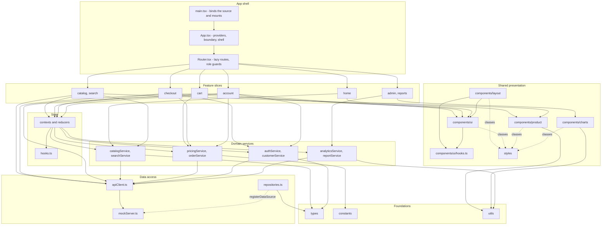
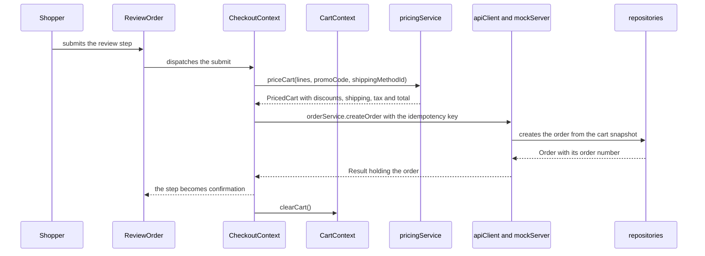
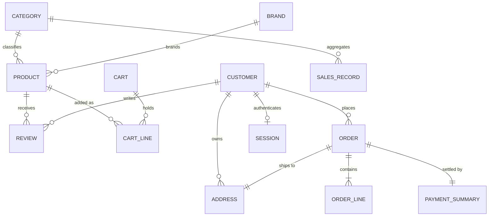

<!--
Path: docs/architecture.md
Purpose: The layers, the import rules and the data flow any new file must fit
Lines: 334
-->

# Architecture

SalesPro is one client-rendered React 19 + TypeScript application: a storefront and a sales back office in the same bundle, with no server, database or external service anywhere in it. Every request is answered in the browser by `src/lib/mockServer.ts` behind `src/lib/apiClient.ts`, and the eight pieces of durable state in the product — the cart, the session, the session table (`salespro.sessions`), the two secrets those records and the placement record are sealed with (`salespro.session-seal`, `salespro.placement-seal`), the last-used report range, the read credential of each order this browser placed (`salespro.order-tokens`) and this browser's own writes to the seeded collections (`salespro.writes`), listed in §9 — are kept in `localStorage` through `src/utils/storage.ts`.

This document fixes where a new file belongs, which imports are legal, how data moves through the product, and where a change of a given kind lands. The endpoint contract lives in `docs/mock-api.md`; the naming, file-size, duplication and formatting conventions live in `docs/contributing.md`.

## 1. The layers

| Layer               | Modules                                                                                          | Responsibility                                                                                                                                                                                                                                                                                                        | Phases     |
| ------------------- | ------------------------------------------------------------------------------------------------ | --------------------------------------------------------------------------------------------------------------------------------------------------------------------------------------------------------------------------------------------------------------------------------------------------------------------- | ---------- |
| Foundations         | `src/types`, `src/constants`, `src/utils`                                                        | Shapes, literals and pure helpers. No React, no data access                                                                                                                                                                                                                                                           | 3–6        |
| Data access         | `src/data`, `src/lib/apiClient.ts`, `src/lib/mockServer.ts`                                      | The seeded collections, the repositories over them, the in-process API and its transport seam                                                                                                                                                                                                                         | 9, 11–12   |
| Domain services     | `src/lib/*Service.ts`                                                                            | One domain rule per file, published here and implemented one layer down in `src/utils/*Rules.ts` so the data layer may reach it: `authService`, `catalogService`, `searchService`, `pricingService`, `orderService`, `customerService`, `analyticsService`, `reportService`. No React import anywhere under `src/lib` | 9–10       |
| Shared presentation | `src/components`, `src/styles`                                                                   | Layout, UI primitives, product components, hand-written SVG charts, and the design tokens every stylesheet consumes                                                                                                                                                                                                   | 7–8, 15–20 |
| State               | `src/state`                                                                                      | Contexts, reducers and hooks for authentication, cart, catalogue, checkout and toasts                                                                                                                                                                                                                                 | 13–14      |
| Feature slices      | `src/features/` — `home`, `catalog`, `search`, `cart`, `checkout`, `account`, `admin`, `reports` | The eight route-shaped modules                                                                                                                                                                                                                                                                                        | 21–32      |
| App shell           | `src/Router.tsx`, `src/App.tsx`, `src/main.tsx`                                                  | The route table, the provider composition and the mount                                                                                                                                                                                                                                                               | 33         |

**A file may import only from its own layer or from a layer below it.** Nothing imports upward, and that is also why the phases could be generated in the order the table lists: by the time a file was written, everything it reaches already existed.

### Where a layer is split across paths

The 600-line ceiling is never raised. When one concern cannot be held in one file it is split along its own seam into a second path in the same layer, the two together holding what the one file held, and the split path is imported by the concrete path that owns the concern — the product has no barrel `index.ts` anywhere, so an importer always names the file that owns what it needs. `generation-manifest.md`'s Part 1 is the authority on which splits exist and what each draws on, one `# part of <mapped path> <budget>` row per split path; the list below is that inventory read the way a contributor meets it, a bullet per mapped path with the split paths it produced.

- `src/lib/mockServer.ts` → `src/lib/apiContract.ts`, `src/lib/apiRequests.ts`, `src/lib/apiRoutes.ts` and `src/lib/apiOrders.ts`: the contract the in-process API is built on, the reading of a request, the route table with its handlers, and the submission half of `POST /api/orders`.
- `src/lib/catalogService.ts` → `src/utils/catalogRules.ts`: the pure rules behind what a filter leaves, what each facet counts, how a sort orders and how a listing is paged, re-exported by the service that reads through them.
- `src/lib/searchService.ts` → `src/utils/searchRules.ts`: tokenising, weighted scoring and type-ahead ranking.
- `src/lib/pricingService.ts` → `src/utils/pricingRules.ts`: line and order totals, the promo decision, shipping and tax.
- `src/lib/orderService.ts` → `src/utils/orderPlacements.ts` and `src/utils/orderRules.ts`: the read credential this browser holds for each order it placed without an account, and the order numbering, snapshot construction and status transitions.
- `src/lib/authService.ts` → `src/utils/accountRules.ts`: session lifetime and the address book's default flags, one engine from which both this service and the customer service re-export the names they publish.
- `src/lib/analyticsService.ts` → `src/utils/analyticsRules.ts`: period bucketing, KPI aggregation, comparison baselines and top-product performance.
- `src/lib/reportService.ts` → `src/utils/reportRules.ts`: the report catalogue, row building, summaries and the series charted beside a report's table, re-exported by the service that also builds the CSV matrix.
- `src/data/repositories.ts` → `src/data/analyticsGraph.ts`, `src/data/collectionStore.ts`, `src/data/clientWrites.ts` and `src/data/sessionTable.ts`: the loader a first analytics or report read resolves through, the store half over the seeded collections, this browser's own durable writes and the session table a session's own window is read back from.
- `src/utils/format.ts` → `src/utils/formatPrimitives.ts`, which `format.ts` imports one way and re-exports the members consumers read from it.
- `src/utils/dates.ts` → `src/utils/isoInstants.ts` and `src/utils/dateDisplay.ts`, whose names `dates.ts` re-exports so no consumer changes.
- `src/constants/content.ts` → `src/constants/checkoutCopy.ts`, `src/constants/content-account.ts`, `src/constants/content-reports.ts` and `src/constants/content-feedback.ts`: the checkout, account, back-office and feedback registers, all re-exported by `content.ts`, so no consumer changes.
- `src/state/AuthContext.tsx` → `src/state/authSession.ts`: the session's contract as a consumer reads it, the read that revalidates a stored token, and the projections computed from the state.
- `src/state/hooks.ts` → `src/state/asyncQuery.ts`, `src/components/ui/focusHandoff.ts`, `src/state/focusHooks.ts` and `src/state/scrollHooks.ts`, its own suite in `tests/unit/state/hooks.test.ts`, the focus-handoff contract's suite in `tests/components/focusHandoff.test.tsx`, and `src/components/ui/hooks.ts`: the abortable async-data hook, the focus-handoff rule with its contract's suite, the two further view hooks, the state hooks' own suite, and the view-facing hooks the presentation layer's primitives read. Why `src/components/ui/hooks.ts` and `src/components/ui/focusHandoff.ts` sit in that layer rather than beside the state hooks is stated once, in the bullet below on the paths whose layer changed.
- `src/styles/layout.css` → `src/styles/page-header.css` and `src/styles/sidebar.css`: the page header with its breadcrumb trail, and the administrator sidebar's skeleton, each loaded by the mapped sheet with `@import` at the position the moved rules held.
- `src/styles/components.css` → `src/styles/controls.css` and `src/styles/data-display.css`: the button, field and selection primitives, and the cards, badges, data table, pagination and overlays.
- `src/styles/data-display.css` → `src/styles/tabs-accordion.css` and `src/styles/toasts.css`: the tab and disclosure families the Tabs primitive renders, and the toast viewport with the messages it stacks.
- `src/styles/catalog.css` → `src/styles/catalog-landing.css` and `src/styles/catalog-detail.css`: the landing page's bands, and the product detail surfaces.
- `src/styles/commerce.css` → `src/styles/cart.css`, `src/styles/commerce-steps.css` and `src/styles/summary-panel.css`: the cart page with its rows and the mini-cart, the checkout's step indicator, and the order-summary panel register the cart, the checkout and the account share.
- `src/styles/admin-reports.css` → `src/styles/chart-series.css` and `src/styles/placeholders.css`: the chart series paint, and the shape each data-page placeholder takes while its region is loading, which the account sheet loads beside its own rules.
- `src/components/layout/Header.tsx` → `src/features/cart/HeaderCartButton.tsx`: the header's cart trigger, which sits in the cart slice because it reads the cart.
- `src/components/ui/Modal.tsx` → `src/components/ui/Icons.tsx` and `src/components/ui/overlayEngine.ts`: the decorative glyphs the primitives and the feature surfaces render, and the focus, containment, Escape and dismissal engine every overlay shares.
- `src/components/ui/Feedback.tsx` → `src/components/ui/NotFoundView.tsx`: the one not-found view every surface renders.
- `src/components/charts/chartScales.ts` → `src/components/charts/chartGeometry.ts` — which itself split into `src/components/charts/labelMetrics.ts` and `src/components/charts/svgPaths.ts` — `src/components/charts/ChartDataTable.tsx` and `src/components/charts/readoutPlacement.ts`: the mark, path and data-table geometry with the label widths the scales share, the width of one chart label, the SVG path text a chart's marks are drawn from, the paired data table every chart renders as its accessible alternative, and the hover readout's placement.
- `src/components/charts/LineChart.tsx` → `src/components/charts/lineChartModel.ts` and `src/components/charts/ChartPlaceholder.tsx`: the line chart's plot model, and the shape a chart block takes while its series are on their way.
- `src/components/charts/BarChart.tsx` → `src/components/charts/barGeometry.ts`: the bar renderer's own scales, marks, value labels and readout placement.
- `src/components/charts/DonutChart.tsx` → `src/components/charts/donutLabelModel.ts`: where each of a donut's percentages is written, and where its readout is placed.
- `src/features/catalog/CatalogPage.tsx` → `src/features/catalog/CatalogFilterRegion.tsx`: the facet panel and its value list, as the sticky column or the drawer body.
- `src/features/checkout/CheckoutPage.tsx` → `src/features/checkout/CheckoutErrorSummary.tsx` and `src/features/checkout/OrderSummaryPanel.tsx`: the step's summary of what is wrong, and the order summary panel with the priced figures it shows.
- `src/features/account/OrderHistoryPage.tsx` → `src/features/account/OrderHistoryList.tsx`: the status and date filters, the paged table they resolve to and its loading placeholder.
- `src/features/reports/ReportsPage.tsx` → `src/features/reports/ReportPlaceholder.tsx`: the shape a report's body takes while its run is in flight.
- `src/features/admin/AdminDashboardPage.tsx` → `src/components/ui/DateRangeControl.tsx`: the range control both administrator surfaces render.
- `tests/unit/utils/formatting.test.ts` → `tests/unit/utils/dates.test.ts`, `tests/unit/utils/bucketLabels.test.ts`, `tests/unit/utils/strings.test.ts`, `tests/unit/utils/statistics.test.ts`, `tests/unit/utils/csv.test.ts` and `tests/unit/utils/async.test.ts`.
- `tests/unit/utils/collections.test.ts` → `tests/unit/utils/collectionsRanking.test.ts`.
- `tests/unit/lib/catalogSearch.test.ts` → `tests/unit/lib/catalogSearchFlow.test.ts`.
- `tests/unit/lib/pricingService.test.ts` → `tests/unit/lib/pricingSurface.test.ts` and `tests/unit/lib/customerService.test.ts`.
- `tests/unit/lib/analyticsService.test.ts` → `tests/unit/lib/analyticsSeries.test.ts` and `tests/unit/lib/analyticsQueries.test.ts`. `tests/helpers/analyticsHarness.ts` is the same suite's third split path: the fixture surface and the two seam calls the two analytics suites had each declared for themselves.
- `tests/unit/lib/mockServer.test.ts` → `tests/unit/lib/seedInvariants.test.ts`, `tests/unit/lib/mockServerDurability.test.ts`, `tests/unit/lib/mockServerHarness.ts` and `tests/unit/lib/mockServerOrderRead.test.ts`.
- `tests/unit/lib/apiRoutes.test.ts` → `tests/unit/lib/apiRoutesVocabulary.test.ts`: the seam's refusal vocabulary — one rule per parameter, the sentence a present-but-invalid value earns, and the idempotency conflict's own wording.
- `tests/unit/state/transactions.test.ts` → `tests/unit/state/checkout.test.ts`.
- `tests/components/controls.test.tsx` → `tests/components/overlays.test.tsx`: the overlay family's own suite.
- `tests/components/charts.test.tsx` → `tests/components/chartScales.test.ts`.
- `tests/integration/shoppingFlow.test.tsx` → `tests/helpers/journeyHarness.tsx`, `tests/integration/catalogBrowseFlow.test.tsx` and `tests/integration/catalogUrlState.test.tsx`: the harness both journey files read the rendered application through, the catalogue and search cases of the browse-and-add journey, and the catalogue route's query contract with the address bar. That catalogue suite in turn → `tests/integration/catalogSuggestionsFlow.test.tsx`: the suggestion list's keyboard choice, the product page it opens, the review a signed-in customer adds and the addresses that resolve to nothing, split out along the suite's own seam when it went over the request's 600-line ceiling.
- `tests/integration/checkoutFlow.test.tsx` → `tests/integration/checkoutPricingFailure.test.tsx` and `tests/integration/orderConfirmationRefusals.test.tsx`. `tests/helpers/checkoutHarness.ts` is the same suite's third split path: the storefront walk, the shipping and payment step inputs and the advance helper the checkout suites had copied between them.
- `tests/integration/accountFlow.test.tsx` → `tests/integration/accountAddressBook.test.tsx`.
- `tests/integration/adminReportsFlow.test.tsx` → `tests/integration/figureReaders.ts`: the readers a rendered figure is read back out with.
- `src/state/hooks.ts` → `src/components/ui/hooks.ts` and `src/components/ui/focusHandoff.ts`, and `src/lib/orderPlacements.ts` → `src/utils/orderPlacements.ts`: the three paths whose layer changed while the concern each holds did not. The four view-facing hooks — `usePagination`, `useMediaQuery`, `useBreakpoint`, `useOnClickOutside` — and the focus-handoff rule live in the presentation layer because the header and the primitives that read them (the pagination control, the tooltip and the shared overlay engine, and the layout’s `Header.tsx`) sit **below** State, so a need they have has to be reachable downward; the placement store — the read credential this browser holds for each order it placed without an account — moved to Foundations because its readers are the seam’s `src/lib/apiOrders.ts`, in Data access, and `src/lib/orderService.ts`, in Domain services, both above it, which is where the `src/utils/*Rules.ts` engines already sit for the same reason. The state-facing hooks stay where the layer puts them, so each concern has one home and no file imports upward.

The service rule engines are placed in Foundations for a second reason on top of the ceiling: the pure rules a service applies are the same rules `src/data/repositories.ts` and its store half compose to answer a route, and the data module may import only its own layer or one below it. So each engine lives in `src/utils/*Rules.ts` — pricing, order, catalog, search, analytics, report and account — its service re-exports every name it published before, and each rule still has exactly one body. A file below a service never imports the service.

## 2. The two hard rules

1. **No feature slice imports another feature slice.** Anything two features need is promoted into `src/components`, `src/lib`, `src/state` or `src/utils`, and both import it there. This is what lets a module be built, tested and reasoned about on its own.
2. **`src/lib/apiClient.ts` is the only module in the product that knows the data source is a mock.** Everything else calls a typed, promise-returning function and receives a `Result<T>`; repointing the product at a real backend is a change inside that one file.

Three corollaries the tree implements:

- No feature slice imports `src/data`. `src/data/repositories.ts` and its store half `src/data/collectionStore.ts` are the only readers of the seeded collections, and a page reaches them through a service.
- No module under `src/components` or `src/features` imports `src/styles`. `src/main.tsx` is the product's only importer of the eight stylesheets, and the thirteen further sheets reach the page through an `@import` in the sheet each mapping below names: `page-header.css` and `sidebar.css` from `layout.css`; `controls.css` and `data-display.css` from `components.css`; `tabs-accordion.css` and `toasts.css` from `data-display.css`; `catalog-landing.css` and `catalog-detail.css` from `catalog.css`; `cart.css`, `commerce-steps.css` and `summary-panel.css` from `commerce.css`; `chart-series.css` from `admin-reports.css`; and `placeholders.css` from `account.css`. Classes are consumed by name.
- A shared need is imported from the file that owns it: no barrel `index.ts` exists anywhere, so no folder acquires an implicit public API and an importer always names the file that holds the concern. A split keeps that import path: the path a concern was split out of stays the name a consumer imports, re-publishing the split path's names where a consumer read them there and composing the region that moved out where a consumer did not. The kinds of split that carry it recur across the tree rather than forming a fixed list of files — the date and number foundations, the transport seam, the data access module, each service with its rule engine, the chart, overlay, state and copy splits, and the pages whose own regions moved out — so a consumer's import path does not change when a concern is split, and the owner is still named by the path that re-exports it. §1 names every split path in the tree and the path each was split out of.

## 3. Component interaction

Every solid edge is an import, and the dashed edges are not. Two shapes are dashed: the binding of the data source — `src/data/repositories.ts` registers its data source with `src/lib/mockServer.ts` at the composition root (`registerDataSource`), which is what keeps the transport free of a compile-time dependency on the data module — and the four edges into `src/styles`, which record the presentation layer consuming the classes and the tokens those sheets define by name only: `src/main.tsx` is the product's only importer of the eight entry stylesheets, the thirteen sheets beside them reach the page through an `@import` in the sheet that loads each of them, and no file under `src/components` or `src/features` imports a stylesheet at all. The diagram draws the layer-level edges rather than every import: a feature slice reaches the foundations, the state layer and the shared presentation below it, and its files also call the layer's services — and, in three slices, `apiClient` itself — so each feature arrow names the layer a slice's files read rather than every path an import names. The two rules the diagram encodes: no feature slice reaches another (`src/features/home` never imports `src/features/catalog`; the piece both need is promoted below them), and `src/lib/apiClient.ts` is the only module in the product that knows the data source is a mock. The view-facing hooks in `src/components/ui/hooks.ts` are read from beside the primitives by the layout and the primitives themselves, and by the feature pages that compose them — a feature importing presentation has always been a downward import.

## 4. Data flow

### 4.1 Read

route → feature component → a context selector or feature hook → a domain service in `src/lib` → `apiClient.request<T>` → `mockServer` → a repository over the seeded collections → `Result<T>` → back up as a render. Failures travel as values: `request` never rejects, so no page wraps a data call in a `try`/`catch`, and an `{ ok: false }` result becomes either a field-keyed error on a form or an error state with a retry action.

### 4.2 Write

A write runs the same path and then dispatches into the reducer that owns the state it changed — cart actions to `src/state/cartReducer.ts`, checkout actions to `src/state/checkoutReducer.ts`, catalogue load transitions to `src/state/catalogReducer.ts`. No component writes another concern's state.

### 4.3 Query state

Search text, facets, sort and page are the one thing that does not live in React state. They live in the URL's search params and are the single source of truth: `src/state/CatalogContext.tsx` reads them through `useSearchParams` and writes them through the readers and writers in `src/utils/queryParams.ts`, and every setter navigates rather than setting a mirrored copy. The consequence is a reload and a shared link behaving alike: the same URL produces the same result set.

`src/state/catalogReducer.ts` therefore owns only what a request produced — the loaded page, the facet response and the load status, each tagged with `catalogFingerprint(request)` of the query that produced it and holding no filter values at all. The fingerprint is also how a superseded answer is discarded: `isStaleResult` refuses a response whose query is no longer the one on screen.

## 5. Two handoffs that hold the flow together

### 5.1 The data source is bound, not imported

`src/lib/mockServer.ts` declares the interface it needs from the data layer and exports `registerDataSource`; `src/data/repositories.ts` implements it with `salesProDataSource`. The binding is made twice — at module scope in `src/main.tsx`, ahead of the first render, and again in `tests/testUtils.tsx`, which hands the suite the same real seeded source. It is a binding rather than an import because the transport must carry no compile-time dependency on `src/data`: that is what let `src/lib` be generated four phases before the data module it serves, and what will let a real backend replace the mock server without a feature changing. A request that arrives before a binding exists answers `503` with code `data-source-unavailable`; calling `registerDataSource` again is harmless, and the seam holds one source.

### 5.2 A placed order hands the cart its own clear

Cart state belongs to `src/state/CartContext.tsx` and nowhere else. On a successful submission `src/state/CheckoutContext.tsx` calls the cart's `clearCart()` action through `useCartDispatch` — the product's single clearing path, which dispatches the cart reducer's `clear()` — instead of emptying lines itself.

Money changes representation nowhere along that path: it is an integer number of minor units from the seeded collections to the rendered total, and it is formatted only in the view, through `src/utils/format.ts` (`roundMinorUnits`, `formatMoney`, `formatMoneyCompact`).

## 6. The state contract

| Concern                                                                       | Owner                           | Reducer                        | Consumer hooks                                                 |
| ----------------------------------------------------------------------------- | ------------------------------- | ------------------------------ | -------------------------------------------------------------- |
| Session and role                                                              | `src/state/AuthContext.tsx`     | —                              | `useAuth`, `useAuthDispatch`                                   |
| Cart lines, promo code, persistence, the drawer flag and the tile's quick add | `src/state/CartContext.tsx`     | `src/state/cartReducer.ts`     | `useCart`, `useCartDispatch`, `useMiniCartOpen`, `useQuickAdd` |
| Catalogue page, facets and load status, plus the URL-derived filter state     | `src/state/CatalogContext.tsx`  | `src/state/catalogReducer.ts`  | `useCatalog`, `useCatalogFilters`                              |
| Checkout steps, per-step values and submission state                          | `src/state/CheckoutContext.tsx` | `src/state/checkoutReducer.ts` | `useCheckout`                                                  |
| Toast queue                                                                   | `src/state/ToastContext.tsx`    | —                              | `useToast`                                                     |

Two consequences follow from React comparing a context value with `Object.is`:

- **Every provider hands out a memoised value with stable callbacks.** A fresh object or function per render re-renders every consumer of that context, which is why the hooks are split by what a component actually needs rather than by which provider owns the data.
- **Derived values are computed during render**, never stored in state and never written back by an effect. A total, a filtered list and a selected entity are recomputed where they are shown; a stored copy would be a second answer that drifts from the first.

The reducers are pure and exhaustively typed: `cartReducer` clamps a quantity against its line's stock ceiling, `checkoutReducer` defines the steps and their transitions, `catalogReducer` owns load transitions alone. The shared hooks are split by who reads them, which is what keeps every import one-directional. `src/state/hooks.ts` holds the hooks the contexts and the feature pages read — `useLocalStorage`, `useDebouncedValue`, `useAsync` and `useDocumentTitle` — and `src/components/ui/hooks.ts` holds the view-facing hooks the shared primitives and their composing pages read: `usePagination`, `useMediaQuery`, `useBreakpoint` and `useOnClickOutside`, which sit beside the primitives because Shared presentation is a layer **below** State and a primitive reaching into `src/state` would be an import running upward. The focus-handoff rule sits beside them too, in `src/components/ui/focusHandoff.ts`, because the `Header.tsx` that arms it is Shared presentation as well. The tile's add follows the same split: `useQuickAdd`, in `src/state/CartContext.tsx`, is its one home, beside the cart it acts on. The cart's own contexts are split the same way: the drawer flag travels in a context of its own, read through `useMiniCartOpen()`, and `CartActions.readLines()` hands the lines to a control whose activation needs them without subscribing it to them — so opening or closing the drawer re-renders the two components that display the flag and none that read the lines, and a change to the lines re-renders the cart's surfaces and no tile's action row.

The values those primitives render arrive as props or elements from a layer that may read a context. `src/App.tsx` reads the session and the toast queue for the shell's own frame: it hands the shell the account, the sign-out action and the cart trigger — the cart slice's own `HeaderCartButton` element, created once so its identity never changes — and the toast viewport the queue and its dismiss handle, and it passes the routed subtree through as `children` so a re-render of its frame never repaints the page. Those two contexts are read across the whole tree through their hooks, not only there: seventeen files call `useAuth()` and thirteen call `useToast()`, the feature pages (OrderConfirmation, AdminDashboardPage, the four report views, ProductReviews, the account pages) and `src/Router.tsx` among them, with `src/state/CheckoutContext.tsx` reading the session and `src/state/CartContext.tsx` and `src/state/AuthContext.tsx` reading the toast queue — which is why every provider hands out a memoised value with stable callbacks. The header's cart read is the trigger's own, because the header sits **below** the state layer while the cart slice does not: a cart change or a drawer toggle re-renders that button and not the wordmark, the navigation, the search row or the account menu beside it. The product tile follows the same rule from the other side: the surface composing a grid reads the cart through `useQuickAdd` and hands each tile the `onAddToCart` callback it calls, so the tile itself reads no cart.

## 7. The app shell

The shell is three files with one responsibility each, and the split is what lets a test choose its own starting location.

| File             | Owns                                                                                                                                                                                                                                                                                                                                                                                                                                                                                                                                                                                                                                                                                                                                                                                                                                                                                                                                                                                                                                                                                                                       |
| ---------------- | -------------------------------------------------------------------------------------------------------------------------------------------------------------------------------------------------------------------------------------------------------------------------------------------------------------------------------------------------------------------------------------------------------------------------------------------------------------------------------------------------------------------------------------------------------------------------------------------------------------------------------------------------------------------------------------------------------------------------------------------------------------------------------------------------------------------------------------------------------------------------------------------------------------------------------------------------------------------------------------------------------------------------------------------------------------------------------------------------------------------------- |
| `src/main.tsx`   | `StrictMode` and the application's `BrowserRouter`; the eight stylesheet imports in their load-bearing order; the `registerDataSource` binding, made at module scope before the first render; the stale-chunk recovery — the `vite:preloadError` listener registered at module scope, the single guarded reload it makes, `STALE_CHUNK_RECOVERY_WINDOW_MS` (60 s) bounding the next attempt and the session-scoped `SESSION_STORAGE_KEYS.STALE_CHUNK_RECOVERY` marker that records the recovery, read and written through `src/utils/storage.ts` — the product's one door to browser storage — with an in-memory fallback for a browser that refuses the store — and the mount into `#root`, guarded so a document without that element fails with a sentence naming what is missing                                                                                                                                                                                                                                                                                                                                       |
| `src/App.tsx`    | The five providers — `ToastProvider` → `AuthProvider` → `CatalogProvider` → `CartProvider` → `CheckoutProvider`; the shell around the routed content; the error boundary inside the shell; and, beside the shell and so outside the routed region, the `MiniCart` drawer — bound with `React.lazy` at module scope behind a `Suspense` boundary, so the cart slice's drawer travels in its own chunk rather than in the shell's entry bundle — and the `ToastViewport`, which both have to survive a route change. It also reads the session and the toast queue for the shell's frame — the account, the sign-out action and the cart's own trigger element go to the shell, the queue and its dismiss handle to the viewport — and passes the routed subtree through as `children`, so it is the frame's reader rather than the product's only one: the same two contexts are read below it through the hooks, by seventeen files calling `useAuth()` and thirteen calling `useToast()`, the feature pages and `src/Router.tsx` among them, which is why every provider hands out a memoised value with stable callbacks |
| `src/Router.tsx` | `AppRoutes`: one `React.lazy` binding per screen, declared at module top level so a screen keeps its state; one `Suspense` boundary with a page placeholder; the guards — `/account/*` admits `customer` or `admin`, `/admin/*` admits `admin` alone — each turning the visitor away in the way their own session calls for: a visitor with no usable session is sent to the sign-in route with the intended path in that link's `returnTo`, while a session in force whose role the section does not admit is refused at the path it asked for, by the `SectionRefusal` this file renders, so the address bar names the screen shown; and the not-found view                                                                                                                                                                                                                                                                                                                                                                                                                                                              |

`src/App.tsx` mounts the cart slice's `MiniCart` drawer beside the shell, bound lazily so its code is fetched in its own chunk, which is a downward import the topmost layer is allowed to make and the reason `src/features/cart/MiniCart.tsx` appears outside its own slice.

Neither `src/App.tsx` nor `src/Router.tsx` renders a router, and the router sits outermost because `src/state/CatalogContext.tsx` reads the query string through `useSearchParams`. `tests/testUtils.tsx` mounts the same tree under a `MemoryRouter` accordingly, which nests correctly only because no file below it declares one. The layout is composed in `src/App.tsx` around the boundary rather than in the route table, so `src/Router.tsx` stays a route table instead of becoming a second composition root.

## 8. Security architecture

Four controls, in the order they apply.

1. **No network egress.** Every request is resolved in-process by `src/lib/mockServer.ts`. There is no remote surface, so there is nothing to configure for CORS, CSRF or TLS, and no component can reach a third-party service.
2. **No secret in the tree.** The runtime configuration surface is two inert `VITE_` placeholders documented in `.env.example` — `VITE_APP_NAME` and `VITE_API_LATENCY_MS` — and the application runs identically with no `.env` file, because every read supplies a default in `src/constants/config.ts`.
3. **Authorisation is checked where the action happens.** The guards in `src/Router.tsx` keep a visitor out of a screen their session cannot serve, and that is convenience rather than access control: `src/lib/mockServer.ts` re-checks the session on every privileged endpoint, so a customer's orders, addresses and the analytics are decided against the session and not against a URL. Hiding a control is not a permission check.
4. **Every submitted input is validated at the boundary** through `src/utils/validation.ts`, which returns field-keyed error maps. Output relies on React's default escaping; there is no `dangerouslySetInnerHTML`, `eval` or `new Function` anywhere in the product.

**The authentication is an in-browser demonstration store, not a production boundary.** A seeded account holds a salted digest produced by `createCredentialDigest` and checked by `verifyCredential`, both in `src/utils/strings.ts`, which is the single home of the digest for the seed data and the sign-in path alike. A session is an opaque token, minted by `sessionToken`, carrying a role and an expiry (`SESSION_TTL_MS`). A real deployment would move session issue and verification behind the server that `src/lib/apiClient.ts` is designed to be repointed at, because nothing client-side can be a security boundary.

A render failure is caught by the error boundary in `src/App.tsx`, which replaces only the routed content — inside the shell, so the header, the footer and the navigation stay usable — and offers recovery in place beside a way back to the home page. A failed screen degrades to a page a visitor can act on rather than to a blank document.

## 9. Invariants

- **Money is an integer number of minor units end to end**, never a float, and is formatted only through `src/utils/format.ts`.
- **Dates are ISO 8601 strings**, parsed, formatted and bucketed only through `src/utils/dates.ts`, which re-exports the instant primitives of `src/utils/isoInstants.ts`.
- **Identifiers are prefixed strings** (`prod_`, `cat_`, `brd_`, `cus_`, `adr_`, `ord_`, `line_`, `rev_`, `prom_`, `ses_`) produced by the generators in `src/utils/strings.ts`.
- **Persistence has one door.** Nothing writes to `localStorage` outside `src/utils/storage.ts`, and the keys it uses — `salespro.cart`, `salespro.session`, `salespro.sessions`, `salespro.session-seal`, `salespro.placement-seal`, `salespro.order-tokens`, `salespro.writes` and `salespro.report-range` — live in `src/constants/config.ts` with the version stamp that discards a payload written by an older shape rather than migrating it. `salespro.session-seal` is the secret the `salespro.sessions` records are sealed with, and it is held under a key of its own rather than inside the table it seals, because a secret stored beside the records it proves would be replaced along with them. It is rotated when a session ends, so a copy of the table taken before a sign-out no longer proves anything, and each placement record under `salespro.order-tokens` carries its own seal under `salespro.placement-seal`, for the same reason and under a secret of its own so that a sign-out's rotation cannot reach a guest's confirmation. Both seals are **demonstration-grade checks rather than boundaries**: each secret is held in the same browser store the records it proves are, so a script able to write that store can write the secret beside them — the limit `src/data/collectionStore.ts` states for the account store as a whole. `salespro.writes` holds this browser's own writes to the seeded collections — the orders it placed, the accounts it registered with the digests that verify them, the profiles it edited and the address books it wrote — which `src/data/clientWrites.ts` folds onto the seeds when a data source is built, so a document load carries on where the last one left off instead of reading the seed alone; `salespro.order-tokens` holds the read credential a session-less buyer's own confirmation is reopened with. Nothing writes to `sessionStorage` outside that module either: the only other write to browser storage anywhere in the product is `src/main.tsx`'s stale-chunk marker, `SESSION_STORAGE_KEYS.STALE_CHUNK_RECOVERY`, read and written only through `src/utils/storage.ts`'s session functions, and it is `sessionStorage` rather than one of these eight `localStorage` keys because it records a property of the tab's session — when this document last reloaded itself for a stale chunk — and not durable state; the recovery keeps an in-memory stamp as well, for a browser that refuses the store.
- **Paths are written once**, in `src/constants/routes.ts`, together with the builders (`productPath`, `categoryPath`, `loginPath`, `registerPath`, `accountOrderPath`, `orderConfirmationPath`) that keep the route table, the navigation and the links from drifting apart.
- **Text has one home per kind**: every surface's copy in `src/constants/content.ts` and the four split copy modules it re-exports — `src/constants/checkoutCopy.ts` (the checkout and its confirmation), `src/constants/content-account.ts` (the account surfaces), `src/constants/content-reports.ts` (the back office and its reports) and `src/constants/content-feedback.ts` (the feedback register: the loading, failure, outcome and empty-state copy, the shared feedback and toast sentences, the per-surface empty states and the not-found view); and the controlled vocabulary of categories, brands, sort keys, statuses, and the facet and report definitions in `src/constants/taxonomy.ts`.
- **No package outside the three pinned runtime dependencies** of `package.json` — `react`, `react-dom` and `react-router-dom`, the only non-React runtime import in the tree. Everything a library would have supplied — validation, formatting, the charts, the table, CSV — is built here.

## 10. Where a change lands

| The change                                             | Where it goes                                                                                                                                                                                                                                                                                                                                                                                                                       |
| ------------------------------------------------------ | ----------------------------------------------------------------------------------------------------------------------------------------------------------------------------------------------------------------------------------------------------------------------------------------------------------------------------------------------------------------------------------------------------------------------------------- |
| A new field on an entity                               | The shape in `src/types`, then the seed generators in `src/data`, then whichever service reads it                                                                                                                                                                                                                                                                                                                                   |
| A new pricing, filtering, ordering or aggregation rule | Exactly one home one layer down in `src/utils`: `pricingRules.ts`, `catalogRules.ts`, `searchRules.ts`, `orderRules.ts`, `analyticsRules.ts` or `reportRules.ts`, which the matching service in `src/lib` — `pricingService`, `catalogService`, `searchService`, `orderService`, `analyticsService`, `reportService` — re-exports, so a caller reaches the rule through the file that publishes it and the rule itself has one body |
| A new screen                                           | A slice under `src/features/<module>` plus one lazy route in `src/Router.tsx`                                                                                                                                                                                                                                                                                                                                                       |
| A control two features need                            | `src/components/ui`, with its section in a stylesheet under `src/styles`                                                                                                                                                                                                                                                                                                                                                            |
| A colour, spacing, radius, shadow or z-index           | `src/styles/tokens.css` only; every other sheet consumes tokens by name                                                                                                                                                                                                                                                                                                                                                             |
| A newly persisted value                                | The access in `src/utils/storage.ts` and the key with its version in `src/constants/config.ts`                                                                                                                                                                                                                                                                                                                                      |
| A different backend                                    | `src/lib/apiClient.ts` and the data source bound to `src/lib/mockServer.ts`; no feature, context or component changes                                                                                                                                                                                                                                                                                                               |

The stated evolution path is the last row: replace the mock transport inside `src/lib/apiClient.ts` with real HTTP calls, leave every feature untouched, and keep the endpoint shapes in `docs/mock-api.md` as the contract both sides are written against.

## 11. Entity relationships

`SalesRecord` is keyed by category and channel and carries no product key, which is why the dashboard's revenue figures are read from the daily fact table in `src/data/salesHistory.ts`, while product performance is computed from the order collection, where every order line carries its product id, name and quantity.
