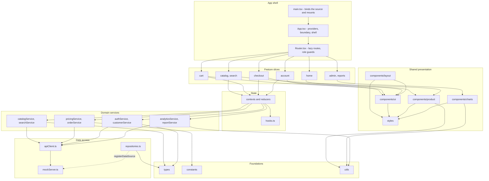
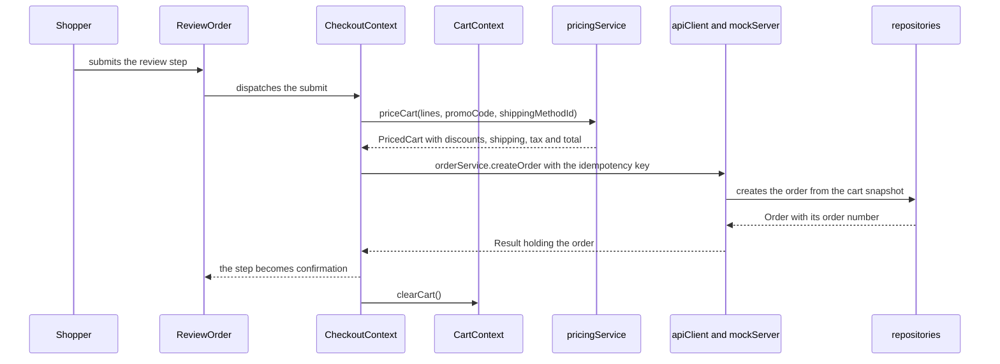
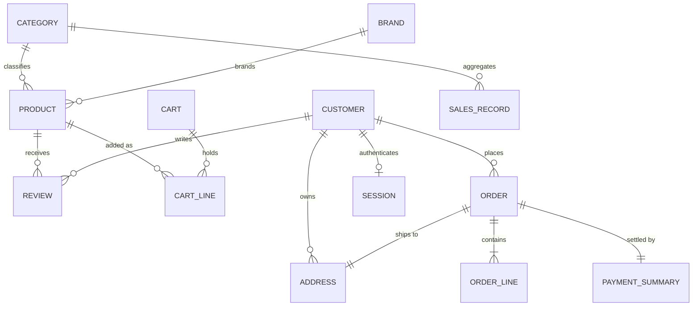

<!--
Path: docs/architecture.md
Purpose: The layers, the import rules and the data flow any new file must fit
Lines: 274
-->

# Architecture

SalesPro is one client-rendered React 19 + TypeScript application: a storefront and a sales back office in the same bundle, with no server, database or external service anywhere in it. Every request is answered in the browser by `src/lib/mockServer.ts` behind `src/lib/apiClient.ts`, and the only durable state in the product is the cart and the session, kept in `localStorage` through `src/utils/storage.ts`.

This document fixes where a new file belongs, which imports are legal, how data moves through the product, and where a change of a given kind lands. The endpoint contract lives in `docs/mock-api.md`; the naming, file-size, duplication and formatting conventions live in `docs/contributing.md`.

## 1. The layers

| Layer               | Modules                                                                                          | Responsibility                                                                                                                                                                                                 | Phases     |
| ------------------- | ------------------------------------------------------------------------------------------------ | -------------------------------------------------------------------------------------------------------------------------------------------------------------------------------------------------------------- | ---------- |
| Foundations         | `src/types`, `src/constants`, `src/utils`                                                        | Shapes, literals and pure helpers. No React, no data access                                                                                                                                                    | 3–6        |
| Data access         | `src/data`, `src/lib/apiClient.ts`, `src/lib/mockServer.ts`                                      | The seeded collections, the repositories over them, the in-process API and its transport seam                                                                                                                  | 9, 11–12   |
| Domain services     | `src/lib/*Service.ts`                                                                            | One domain rule per file: `authService`, `catalogService`, `searchService`, `pricingService`, `orderService`, `customerService`, `analyticsService`, `reportService`. No React import anywhere under `src/lib` | 9–10       |
| Shared presentation | `src/components`, `src/styles`                                                                   | Layout, UI primitives, product components, hand-written SVG charts, and the design tokens every stylesheet consumes                                                                                            | 7–8, 15–20 |
| State               | `src/state`                                                                                      | Contexts, reducers and hooks for authentication, cart, catalogue, checkout and toasts                                                                                                                          | 13–14      |
| Feature slices      | `src/features/` — `home`, `catalog`, `search`, `cart`, `checkout`, `account`, `admin`, `reports` | The eight route-shaped modules                                                                                                                                                                                 | 21–32      |
| App shell           | `src/Router.tsx`, `src/App.tsx`, `src/main.tsx`                                                  | The route table, the provider composition and the mount                                                                                                                                                        | 33         |

**A file may import only from its own layer or from a layer below it.** Nothing imports upward, and that is also why the phases could be generated in the order the table lists: by the time a file was written, everything it reaches already existed.

### Where a layer is split across paths

The 600-line ceiling is never raised. When one concern cannot be held in one file it is split along its own seam into a second path in the same layer, the two together holding what the one file held, and the split path is imported by the concrete path that owns the concern — the product has no barrel `index.ts` anywhere, so an importer always names the file that owns what it needs.

- `src/lib/mockServer.ts` → `src/lib/apiContract.ts`, `src/lib/apiRoutes.ts`, `src/lib/apiRequests.ts`, `src/lib/apiOrders.ts`
- `src/lib/reportService.ts` → `src/lib/reportSeries.ts`; `src/data/repositories.ts` → `src/data/collectionStore.ts`
- the chart files → `src/components/charts/chartGeometry.ts`, `barGeometry.ts`, `lineChartModel.ts`
- `src/utils/dates.ts` → `src/utils/isoInstants.ts`, whose names `dates.ts` re-exports so no consumer changes
- `src/styles/catalog.css` → `src/styles/catalog-landing.css`, `src/styles/catalog-detail.css`

## 2. The two hard rules

1. **No feature slice imports another feature slice.** Anything two features need is promoted into `src/components`, `src/lib`, `src/state` or `src/utils`, and both import it there. This is what lets a module be built, tested and reasoned about on its own.
2. **`src/lib/apiClient.ts` is the only module in the product that knows the data source is a mock.** Everything else calls a typed, promise-returning function and receives a `Result<T>`; repointing the product at a real backend is a change inside that one file.

Three corollaries the tree implements:

- No feature slice imports `src/data`. `src/data/repositories.ts` and its store half `src/data/collectionStore.ts` are the only readers of the seeded collections, and a page reaches them through a service.
- No module under `src/components` or `src/features` imports `src/styles`. `src/main.tsx` is the product's only importer of the eight stylesheets, and the further sheets (`controls.css`, `data-display.css`, `page-header.css`, `tabs-accordion.css`, `catalog-landing.css`, `catalog-detail.css`) reach the page through `@import`. Classes are consumed by name.
- A shared need is imported from the file that owns it, never through a re-export that hides the owner.

## 3. Component interaction

Every solid edge is an import. The two rules the diagram encodes: no feature slice reaches another (`src/features/home` never imports `src/features/catalog`; the piece both need is promoted below them), and the single dashed edge is a binding rather than an import — `src/data/repositories.ts` registers its data source with `src/lib/mockServer.ts` at the composition root, which is what keeps the transport free of a compile-time dependency on the data module.

## 4. Data flow

### 4.1 Read

route → feature component → a context selector or feature hook → a domain service in `src/lib` → `apiClient.request<T>` → `mockServer` → a repository over the seeded collections → `Result<T>` → back up as a render. Failures travel as values: `request` never rejects, so no page wraps a data call in a `try`/`catch`, and an `{ ok: false }` result becomes either a field-keyed error on a form or an error state with a retry action.

### 4.2 Write

A write runs the same path and then dispatches into the reducer that owns the state it changed — cart actions to `src/state/cartReducer.ts`, checkout actions to `src/state/checkoutReducer.ts`, catalogue load transitions to `src/state/catalogReducer.ts`. No component writes another concern's state.

### 4.3 Query state

Search text, facets, sort and page are the one thing that does not live in React state. They live in the URL's search params and are the single source of truth: `src/state/CatalogContext.tsx` reads them through `useSearchParams` and writes them through the readers and writers in `src/utils/queryParams.ts`, and every setter navigates rather than setting a mirrored copy. The consequence is a reload and a shared link behaving alike: the same URL produces the same result set.

`src/state/catalogReducer.ts` therefore owns only what a request produced — the loaded page, the facet response and the load status, each tagged with `catalogFingerprint(request)` of the query that produced it and holding no filter values at all. The fingerprint is also how a superseded answer is discarded: `isStaleResult` refuses a response whose query is no longer the one on screen.

## 5. Two handoffs that hold the flow together

### 5.1 The data source is bound, not imported

`src/lib/mockServer.ts` declares the interface it needs from the data layer and exports `registerDataSource`; `src/data/repositories.ts` implements it with `salesProDataSource`. The binding is made twice — at module scope in `src/main.tsx`, ahead of the first render, and again in `tests/testUtils.tsx`, which hands the suite the same real seeded source. It is a binding rather than an import because the transport must carry no compile-time dependency on `src/data`: that is what let `src/lib` be generated four phases before the data module it serves, and what will let a real backend replace the mock server without a feature changing. A request that arrives before a binding exists answers `503` with code `data-source-unavailable`; calling `registerDataSource` again is harmless, and the seam holds one source.

### 5.2 A placed order hands the cart its own clear

Cart state belongs to `src/state/CartContext.tsx` and nowhere else. On a successful submission `src/state/CheckoutContext.tsx` calls the cart's `clearCart()` action through `useCartDispatch` — the product's single clearing path, which dispatches the cart reducer's `clear()` — instead of emptying lines itself.

Money changes representation nowhere along that path: it is an integer number of minor units from the seeded collections to the rendered total, and it is formatted only in the view, through `src/utils/format.ts` (`roundMinorUnits`, `formatMoney`, `formatMoneyCompact`).

## 6. The state contract

| Concern                                                                   | Owner                           | Reducer                        | Consumer hooks                    |
| ------------------------------------------------------------------------- | ------------------------------- | ------------------------------ | --------------------------------- |
| Session and role                                                          | `src/state/AuthContext.tsx`     | —                              | `useAuth`, `useAuthDispatch`      |
| Cart lines, promo code, persistence and mini-cart visibility              | `src/state/CartContext.tsx`     | `src/state/cartReducer.ts`     | `useCart`, `useCartDispatch`      |
| Catalogue page, facets and load status, plus the URL-derived filter state | `src/state/CatalogContext.tsx`  | `src/state/catalogReducer.ts`  | `useCatalog`, `useCatalogFilters` |
| Checkout steps, per-step values and submission state                      | `src/state/CheckoutContext.tsx` | `src/state/checkoutReducer.ts` | `useCheckout`                     |
| Toast queue                                                               | `src/state/ToastContext.tsx`    | —                              | `useToast`                        |

Two consequences follow from React comparing a context value with `Object.is`:

- **Every provider hands out a memoised value with stable callbacks.** A fresh object or function per render re-renders every consumer of that context, which is why the hooks are split by what a component actually needs rather than by which provider owns the data.
- **Derived values are computed during render**, never stored in state and never written back by an effect. A total, a filtered list and a selected entity are recomputed where they are shown; a stored copy would be a second answer that drifts from the first.

The reducers are pure and exhaustively typed: `cartReducer` clamps a quantity against its line's stock ceiling, `checkoutReducer` defines the steps and their transitions, `catalogReducer` owns load transitions alone. The hooks every feature shares live in `src/state/hooks.ts`: `useLocalStorage`, `useDebouncedValue`, `usePagination`, `useMediaQuery`, `useBreakpoint`, `useAsync`, `useDocumentTitle` and `useOnClickOutside`.

## 7. The app shell

The shell is three files with one responsibility each, and the split is what lets a test choose its own starting location.

| File             | Owns                                                                                                                                                                                                                                                                                                                                              |
| ---------------- | ------------------------------------------------------------------------------------------------------------------------------------------------------------------------------------------------------------------------------------------------------------------------------------------------------------------------------------------------- |
| `src/main.tsx`   | `StrictMode` and the application's `BrowserRouter`; the eight stylesheet imports in their load-bearing order; the `registerDataSource` binding, made at module scope before the first render; the mount into `#root`, guarded so a document without that element fails with a sentence naming what is missing                                     |
| `src/App.tsx`    | The five providers — `ToastProvider` → `AuthProvider` → `CatalogProvider` → `CartProvider` → `CheckoutProvider`; the shell around the routed content; the error boundary inside the shell; and, beside the shell and so outside the routed region, the `MiniCart` drawer and the `ToastViewport`, which both have to survive a route change       |
| `src/Router.tsx` | `AppRoutes`: one `React.lazy` binding per screen, declared at module top level so a screen keeps its state; one `Suspense` boundary with a page placeholder; the guards — `/account/*` admits `customer` or `admin`, `/admin/*` admits `admin` alone — each preserving the intended path in the sign-in link's `returnTo`; and the not-found view |

`src/App.tsx` mounts the cart slice's `MiniCart` drawer beside the shell, which is a downward import the topmost layer is allowed to make and the reason `src/features/cart/MiniCart.tsx` appears outside its own slice.

Neither `src/App.tsx` nor `src/Router.tsx` renders a router, and the router sits outermost because `src/state/CatalogContext.tsx` reads the query string through `useSearchParams`. `tests/testUtils.tsx` mounts the same tree under a `MemoryRouter` accordingly, which nests correctly only because no file below it declares one. The layout is composed in `src/App.tsx` around the boundary rather than in the route table, so `src/Router.tsx` stays a route table instead of becoming a second composition root.

## 8. Security architecture

Four controls, in the order they apply.

1. **No network egress.** Every request is resolved in-process by `src/lib/mockServer.ts`. There is no remote surface, so there is nothing to configure for CORS, CSRF or TLS, and no component can reach a third-party service.
2. **No secret in the tree.** The runtime configuration surface is two inert `VITE_` placeholders documented in `.env.example` — `VITE_APP_NAME` and `VITE_API_LATENCY_MS` — and the application runs identically with no `.env` file, because every read supplies a default in `src/constants/config.ts`.
3. **Authorisation is checked where the action happens.** The guards in `src/Router.tsx` keep a visitor out of a screen their session cannot serve, and that is convenience rather than access control: `src/lib/mockServer.ts` re-checks the session on every privileged endpoint, so a customer's orders, addresses and the analytics are decided against the session and not against a URL. Hiding a control is not a permission check.
4. **Every submitted input is validated at the boundary** through `src/utils/validation.ts`, which returns field-keyed error maps. Output relies on React's default escaping; there is no `dangerouslySetInnerHTML`, `eval` or `new Function` anywhere in the product.

**The authentication is an in-browser demonstration store, not a production boundary.** A seeded account holds a salted digest produced by `createCredentialDigest` and checked by `verifyCredential`, both in `src/utils/strings.ts`, which is the single home of the digest for the seed data and the sign-in path alike. A session is an opaque token, minted by `sessionToken`, carrying a role and an expiry (`SESSION_TTL_MS`). A real deployment would move session issue and verification behind the server that `src/lib/apiClient.ts` is designed to be repointed at, because nothing client-side can be a security boundary.

A render failure is caught by the error boundary in `src/App.tsx`, which replaces only the routed content — inside the shell, so the header, the footer and the navigation stay usable — and offers recovery in place beside a way back to the home page. A failed screen degrades to a page a visitor can act on rather than to a blank document.

## 9. Invariants

- **Money is an integer number of minor units end to end**, never a float, and is formatted only through `src/utils/format.ts`.
- **Dates are ISO 8601 strings**, parsed, formatted and bucketed only through `src/utils/dates.ts`, which re-exports the instant primitives of `src/utils/isoInstants.ts`.
- **Identifiers are prefixed strings** (`prod_`, `cat_`, `brd_`, `cus_`, `adr_`, `ord_`, `line_`, `rev_`, `prom_`, `ses_`) produced by the generators in `src/utils/strings.ts`.
- **Persistence has one door.** Nothing writes to `localStorage` outside `src/utils/storage.ts`, and the keys it uses — `salespro.cart`, `salespro.session`, `salespro.report-range` — live in `src/constants/config.ts` with the version stamp that discards a payload written by an older shape rather than migrating it.
- **Paths are written once**, in `src/constants/routes.ts`, together with the builders (`productPath`, `categoryPath`, `loginPath`, `registerPath`, `accountOrderPath`, `orderConfirmationPath`) that keep the route table, the navigation and the links from drifting apart.
- **Text has one home per kind**: all user-facing copy in `src/constants/content.ts`, the controlled vocabulary of categories, brands, sort keys, statuses, and the facet and report definitions in `src/constants/taxonomy.ts`.
- **No package outside the three pinned runtime dependencies** of `package.json` — `react`, `react-dom` and `react-router-dom`, the only non-React runtime import in the tree. Everything a library would have supplied — validation, formatting, the charts, the table, CSV — is built here.

## 10. Where a change lands

| The change                                             | Where it goes                                                                                                                             |
| ------------------------------------------------------ | ----------------------------------------------------------------------------------------------------------------------------------------- |
| A new field on an entity                               | The shape in `src/types`, then the seed generators in `src/data`, then whichever service reads it                                         |
| A new pricing, filtering, ordering or aggregation rule | Exactly one home in `src/lib`: `pricingService`, `catalogService`, `searchService`, `orderService`, `analyticsService` or `reportService` |
| A new screen                                           | A slice under `src/features/<module>` plus one lazy route in `src/Router.tsx`                                                             |
| A control two features need                            | `src/components/ui`, with its section in a stylesheet under `src/styles`                                                                  |
| A colour, spacing, radius, shadow or z-index           | `src/styles/tokens.css` only; every other sheet consumes tokens by name                                                                   |
| A newly persisted value                                | The access in `src/utils/storage.ts` and the key with its version in `src/constants/config.ts`                                            |
| A different backend                                    | `src/lib/apiClient.ts` and the data source bound to `src/lib/mockServer.ts`; no feature, context or component changes                     |

The stated evolution path is the last row: replace the mock transport inside `src/lib/apiClient.ts` with real HTTP calls, leave every feature untouched, and keep the endpoint shapes in `docs/mock-api.md` as the contract both sides are written against.

## 11. Entity relationships

`SalesRecord` is keyed by category and channel and carries no product key, which is why the dashboard's revenue figures are read from the daily fact table in `src/data/salesHistory.ts`, while product performance is computed from the order collection, where every order line carries its product id, name and quantity.
